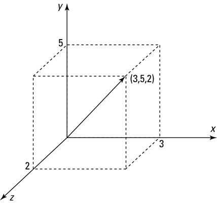

# 03-002: Vectores

## 2.1. ¿Qué es un vector?

Un vector es un **objeto matemático** que, en este bloque, representaremos mediante una **secuencia ordenada de componentes numéricos**.  

Por ejemplo:  

$$
\mathbf{v} = (3, 5, 2)
$$

Este vector tiene tres componentes:  

- **Primer componente:** $3$
- **Segundo componente:** $5$
- **Tercer componente:** $2$

> [!IMPORTANT]
> **El orden importa:** $(3,5,2)$ y $(5,3,2)$ son vectores **diferentes**.

Un vector puede representar distintos tipos de información, según el contexto:  

- Las coordenadas de un punto en el espacio.
- Los precios de tres productos.
- Las mediciones de temperatura de tres sensores.
- Las características numéricas de una observación en un conjunto de datos.

Un vector tridimensional puede representarse geométricamente como **una flecha desde el origen hasta un punto**. Los componentes determinan su posición.  

***

### 2.1.1.  ¿Qué relación tiene con los escalares?

Un **escalar** representa un único valor; un **vector** agrupa varios componentes ordenados.

| Escalar                | Vector                                     |
| ---------------------- | ------------------------------------------ |
| $5$                    | $(3,5,2)$                                  |
| Una temperatura        | Temperaturas de varios sensores            |
| Un precio              | Precios de varios productos                |
| Un único dato numérico | Una observación con varias características |

> [!NOTE]
> Un vector **no tiene por qué** representar una posición geométrica. En análisis de datos, se usa a menudo para representar una colección ordenada de valores numéricos.  

> [!WARNING]
> Una lista de Python puede almacenar números y parecerse a un vector, pero **una lista no es automáticamente un vector matemático**.  
>  
> La estructura de datos y el objeto matemático son conceptos diferentes.  

---
