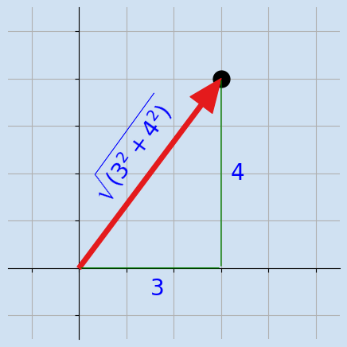

# 03-003:   Vectores

***

## 2.4. Norma o longitud de un vector

La **norma** de un vector es una medida de su **magnitud**.

- En el caso más habitual que utilizaremos aquí, la **norma euclídea, o L2**, representa la **longitud geométrica** del vector.

Consideremos:

$$
\mathbf{v} = (3, 4)
$$

Podemos interpretar este vector como:

- Un desplazamiento de **3 unidades** en un eje.
- Otro desplazamiento de **4 unidades** en el otro eje.

Su longitud se calcula aplicando el **teorema de Pitágoras**.  



> [!IMPORTANT]
> La norma euclídea corresponde a la **hipotenusa** del triángulo formado por las componentes del vector.

> [!TIP]
> **Referencias de interés**
>
> 1. [swdevnotes.com](https://swdevnotes.com/python/2020/math-2d-vectors/)
> 2. [Math for Programmers](https://www.manning.com/books/math-for-programmers)

***

### 2.4.1.  Fórmula

Para un vector bidimensional:  

$$
\|\mathbf{v}\|_2 = \sqrt{v_1^2 + v_2^2}
$$

Por tanto, si un eje era $3$ y otro eje era $4$:  

$$
\begin{aligned}
\|\mathbf{v}\|_2 &= \sqrt{3^2 + 4^2} \\
&= \sqrt{9 + 16} \\
&= \sqrt{25} \\
&= \boxed{5}
\end{aligned}
$$

Para un vector con $n$ componentes, la fórmula se generaliza:  

$$
\|\mathbf{v}\|_2 = \sqrt{\sum_{i=1}^{n} v_i^2}
$$

- Es decir: **elevamos** cada componente al cuadrado, **sumamos** los resultados y **calculamos la raíz cuadrada**.  

***

### 2.4.2.  Calcular la norma con NumPy

La forma habitual es utilizar `numpy.linalg.norm(VECTOR)`.

```python
vector = np.array([3, 4])
norma = np.linalg.norm(vector)

print(norma)  # 5.0
```

> [!NOTE]
> `np.linalg.norm()` admite varios tipos de norma. Si no especificamos el parámetro `ord`, para un vector utiliza por defecto la **norma euclídea**, también denominada **norma L2**.

***

### 2.4.3.  Otras normas que conviene conocer

Consideremos el vector $\mathbf{v} = (3, -4)$.

| Norma             | Fórmula                       | Resultado | ¿Cuándo se usa?                                              |
| ----------------- | ----------------------------- | --------- | ------------------------------------------------------------ |
| **L1**            | Suma de los valores absolutos | $7$       | Distancia por cuadrícula; modelos que buscan ceros (Lasso)   |
| **L2 o euclídea** | Raíz de la suma de cuadrados  | $5$       | Distancia en línea recta; la opción por defecto (KNN, Ridge) |
| **L∞**            | Máximo valor absoluto         | $4$       | Peor caso; tolerancias ("ninguna componente supera X")       |

> [!NOTE]
> Aquí solo las presentamos. Más adelante las trabajaremos a fondo, con sus aplicaciones.

En NumPy:

```python
vector = np.array([3, -4])

print(np.linalg.norm(vector, ord=1))       # 7.0
print(np.linalg.norm(vector, ord=2))       # 5.0
print(np.linalg.norm(vector))              # 5.0 (sin ord: L2 por defecto)
print(np.linalg.norm(vector, ord=np.inf))  # 4.0
```

- **L1:** suma distancias absolutas. Imagina moverte por calles en cuadrícula: solo puedes ir en horizontal y vertical.
- **L2:** mide la longitud euclídea, la "línea recta" de siempre.
- **L∞:** toma la mayor magnitud absoluta. Solo importa la componente más grande.

> [!WARNING]
> Para la norma L∞ se usa `ord=np.inf`, **no** un número ni un texto.

> [!TIP]
> **El infinito en Python:** `np.inf` es un `float` estándar, no un tipo propio de NumPy. NumPy solo expone el valor.
>
> ```python
> print(type(np.inf))      # <class 'float'>
> print(10**100 < np.inf)  # True
> print(-np.inf)           # -inf
> ```
>
> Es mayor que cualquier número finito, y por eso encaja con "el máximo".

> [!NOTE]
> En aprendizaje automático, estas normas aparecen en la medición de distancias, la normalización de datos y la regularización de modelos. Por ahora, lo importante es **entender qué calcula cada una**, no memorizar todas sus aplicaciones.


> [!IMPORTANT]
> Al operar de forma manual para obtener la L1 y L∞, en vez de usar `np.linalg.norm(producto, ord=X )`, **siempre se deben usar/convertir las componentes a VALORES ABSOLUTOS**:  
>
> Por ejemplo, con np.abs(vector), construyéndolo como np.max(np.abs(vector)), obtienes la medida perfecta, pues has usado valores absolutos para calcularlo.


---
