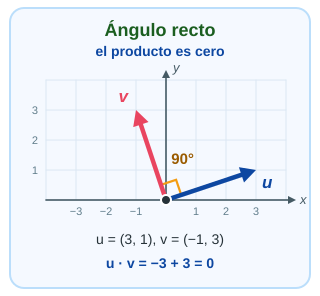
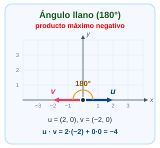

# 03-002:   Vectores

***

## 2.6. Relación entre producto escalar, norma y ángulo

Este concepto conecta directamente con las **normas** que acabamos de estudiar y será útil para comprender la **similitud entre vectores** en aprendizaje automático.  

El producto escalar también se puede expresar mediante las **normas euclídeas** y el **ángulo** entre los vectores:  

$$
\mathbf{u} \cdot \mathbf{v} = \|\mathbf{u}\|_2 \, \|\mathbf{v}\|_2 \cos(\theta)
$$

Donde $\theta$ (theta) es el ángulo entre ambos vectores.  

***

### 2.6.1. Intuición: el coseno mide la alineación

Las normas solo dan las **longitudes**. Lo que decide el signo y el tamaño del resultado es $\cos(\theta)$, que mide **cuánto apuntan los vectores en la misma dirección**:  

```text
  θ = 0°     u ──►   v ──►     misma dirección        cos = +1
  θ = 90°    u ──►   v ↑       perpendiculares        cos =  0
  θ = 180°   u ──►   v ◄──     direcciones opuestas   cos = -1
```

| Ángulo $\theta$ | Tipo de Ángulo | $\cos(\theta)$ | Producto escalar | Interpretación Geométrica |
| --- | --- | --- | --- | --- |
| $0^\circ$ | **Nulo** | $1$ | Máximo positivo | Apuntan en la **misma dirección y sentido** |
|||||
| Entre $0^\circ$ y $90^\circ$ | **Agudo** | Positivo | **Positivo** | Apuntan en una dirección similar |
|||||
| $90^\circ$ | **Recto** | $0$ | **Cero** | Son **perpendiculares / ortogonales** |
|||||
| Entre $90^\circ$ y $180^\circ$ | **Obtuso** | Negativo | **Negativo** | Apuntan en direcciones opuestas |
|||||
| $180^\circ$ | **Llano** | $-1$ | Máximo negativo | Apuntan en la **misma dirección pero sentido opuesto** |


#### 2.6.1.2  El signo del producto escalar

Como los módulos siempre son positivos, el signo del producto escalar lo decide el coseno, es decir, el ángulo. Mira estos casos:  






> [!TIP]
> Piensa en el producto escalar como una pregunta:  
>     **"¿Hacia dónde apunta cada uno respecto al otro?"**:  
>       - Positivo, van más o menos juntos  
>       - Cero, no se influyen  
>       - Negativo, se oponen  


- Referencias de Interés para sección 2.5 y 2.6
    - [https://soymatematicas.com/producto-escalar/](https://soymatematicas.com/producto-escalar/)

- Generación visual de tipos de ángulos:
    - [Script](./03-002-006_02_Angulos_visualmente.py)


***

### 2.6.2. Despejar el ángulo

Si conocemos los vectores, podemos **obtener el ángulo** despejando $\cos(\theta)$:  

$$
\cos(\theta) = \frac{\mathbf{u} \cdot \mathbf{v}}{\|\mathbf{u}\|_2 \, \|\mathbf{v}\|_2}
\qquad \Rightarrow \qquad
\theta = \arccos\left(\frac{\mathbf{u} \cdot \mathbf{v}}{\|\mathbf{u}\|_2 \, \|\mathbf{v}\|_2}\right)
$$

El cálculo siempre sigue **cuatro pasos**:  

1. Calcular el producto escalar $\mathbf{u} \cdot \mathbf{v}$.
2. Calcular las normas $\|\mathbf{u}\|_2$ y $\|\mathbf{v}\|_2$.
3. Dividir para obtener $\cos(\theta)$.
4. Aplicar $\arccos$ para obtener $\theta$.

#### 2.6.2.2. Ejemplo con $\mathbf{u} = (7, 9)$ y $\mathbf{v} = (-5, 3)$

$$
\begin{aligned}
\mathbf{u} \cdot \mathbf{v} &= 7 \cdot (-5) + 9 \cdot 3 = -35 + 27 = -8 \\
\|\mathbf{u}\|_2 &= \sqrt{7^2 + 9^2} = \sqrt{130} \approx 11.40 \\
\|\mathbf{v}\|_2 &= \sqrt{(-5)^2 + 3^2} = \sqrt{34} \approx 5.83 \\
\cos(\theta) &= \frac{-8}{11.40 \cdot 5.83} \approx -0.12 \\
\theta &= \arccos(-0.12) \approx \boxed{96.9^\circ}
\end{aligned}
$$

El producto escalar es **negativo**, así que el ángulo es **obtuso** (mayor de $90^\circ$). Aquí está cerca de $90^\circ$ porque el producto escalar es pequeño comparado con las longitudes.  

***

### 2.6.3. Visualización


- **Par 1:** perpendiculares, $90^\circ$.
- **Par 2:** agudo, $26.6^\circ$.
- **Par 4:** el ejemplo anterior, obtuso, $96.9^\circ$.
- **Par 5:** direcciones opuestas, $180^\circ$.

***


> [!NOTE]
> Los pares 3 y 6 de la imagen no se dibujan a propósito: el primero tiene una componente nula (`None`) y el segundo un vector cero, que no tiene dirección.

***

### 2.6.4. Cálculo con NumPy

```python
u = np.array([7, 9])
v = np.array([-5, 3])

cos_theta = (u @ v) / (np.linalg.norm(u) * np.linalg.norm(v))
theta = np.degrees(np.arccos(np.clip(cos_theta, -1, 1)))

print(cos_theta)  # -0.1203...
print(theta)      # 96.91...
```

- `np.arccos()` devuelve el ángulo en **radianes**.
- `np.degrees()` lo convierte a **grados**.
- `np.clip(cos_theta, -1, 1)`, con estos valores exactos, nos ayudará a evitar NaN's por errores de redondeo.


> [!WARNING]
> Por errores de redondeo, `cos_theta` puede salir como `1.0000000000000002` y `np.arccos` devolvería `nan`. Por eso se usa `np.clip(cos_theta, -1, 1)`.

> [!IMPORTANT]
> Si alguno de los vectores es el **vector cero**, su norma es $0$, la división falla y **no existe ángulo**: el vector cero no tiene dirección.  
>  
>  Además, un producto escalar igual a cero implica perpendicularidad **solo si ambos vectores son no nulos**.

***

### 2.6.5. Ejemplo mínimo: vectores perpendiculares

```python
u = np.array([1, 0])
v = np.array([0, 1])

producto_escalar = u @ v

print(producto_escalar)  # 0
```

El cálculo es:  

$$
1 \cdot 0 + 0 \cdot 1 = 0
$$

- Como el producto escalar es cero y ambos vectores son no nulos, son **perpendiculares**: $u$ apunta por el eje horizontal y $v$ por el vertical.  


---
