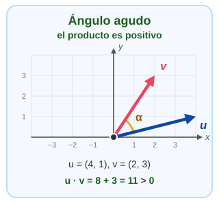
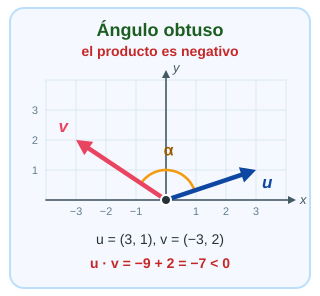
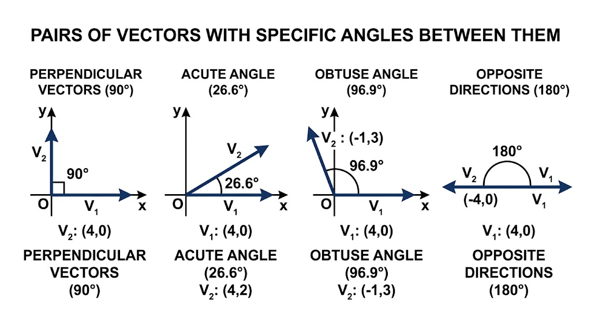
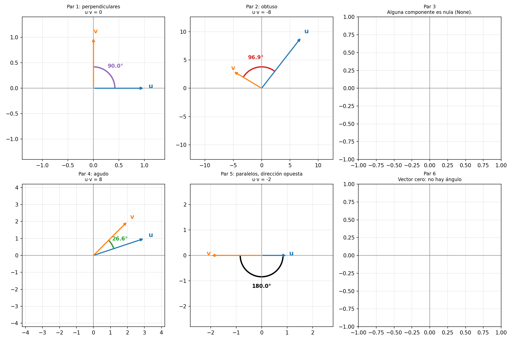

# 03-002: Vectores

## 2.1. ¿Qué es un vector?

Un vector es un **objeto matemático** que, en este bloque, representaremos mediante una **secuencia ordenada de componentes numéricos**.  

Por ejemplo:  

$$
\mathbf{v} = (3, 5, 2)
$$

Este vector tiene tres componentes:  

- **Primer componente:** $3$
- **Segundo componente:** $5$
- **Tercer componente:** $2$

> [!IMPORTANT]
> **El orden importa:** $(3,5,2)$ y $(5,3,2)$ son vectores **diferentes**.

Un vector puede representar distintos tipos de información, según el contexto:  

- Las coordenadas de un punto en el espacio.
- Los precios de tres productos.
- Las mediciones de temperatura de tres sensores.
- Las características numéricas de una observación en un conjunto de datos.


Un vector tridimensional puede representarse geométricamente como **una flecha desde el origen hasta un punto**. Los componentes determinan su posición.  


***

### ¿Qué relación tiene con los escalares?

Un **escalar** representa un único valor; un **vector** agrupa varios componentes ordenados.

| Escalar                | Vector                                     |
| ---------------------- | ------------------------------------------ |
| $5$                    | $(3,5,2)$                                  |
| Una temperatura        | Temperaturas de varios sensores            |
| Un precio              | Precios de varios productos                |
| Un único dato numérico | Una observación con varias características |

> [!NOTE]
> Un vector **no tiene por qué** representar una posición geométrica. En análisis de datos, se usa a menudo para representar una colección ordenada de valores numéricos.  

> [!WARNING]
> Una lista de Python puede almacenar números y parecerse a un vector, pero **una lista no es automáticamente un vector matemático**.  
>  
> La estructura de datos y el objeto matemático son conceptos diferentes.  

---

## 2.2. Representación y dimensión

Podemos representar un vector como una **fila**:

$$
\mathbf{v} = (3, 5, 2)
$$

O como una **columna**:

$$
\mathbf{v} =
\begin{pmatrix}
3 \\
5 \\
2
\end{pmatrix}
$$

Ambas representaciones contienen los mismos valores, pero la **orientación puede importar** en determinadas operaciones matriciales.

La **dimensión** del vector, en este contexto, es el número de componentes que contiene:

| Vector    | Dimensión | Componentes |
| --------- | --------- | ----------- |
| $(7)$     | 1         | 1           |
| $(3,5)$   | 2         | 2           |
| $(3,5,2)$ | 3         | 3           |

> [!WARNING]
> Esta terminología puede confundir: **NumPy usa la palabra "dimensión" para los ejes de un array**, no para el número de componentes. Más adelante distinguiremos ambos significados con precisión.

***

### Índices y componentes

Las componentes se identifican por su **posición**. En matemáticas se usa $v_1, v_2, v_3$ (recuerda que Python es zero-index, **los índices empiezan en cero**).

Para el vector $(3,5,2)$:

| Componente matemático | Valor | Índice Python |
| --------------------- | ----- | ------------- |
| $v_1$                 | 3     | `0`           |
| $v_2$                 | 5     | `1`           |
| $v_3$                 | 2     | `2`           |

### Representación en Python y NumPy

```python
vector_lista = [3, 5, 2]
vector = np.array([3, 5, 2])

print(vector[0])  # 3
print(vector[1])  # 5
print(vector[2])  # 2

print(vector.shape)  # (3,)
print(vector.ndim)   # 1
print(vector.size)   # 3
```

Observa las tres propiedades:

- **`shape`**: forma del array. `(3,)` significa un eje con tres elementos.
- **`ndim`**: número de ejes. Aquí, `1`.
- **`size`**: número total de elementos. Aquí, `3`.

> [!NOTE]
> Aunque el vector matemático tiene **tres componentes**, el array NumPy `vector` tiene **un solo eje**. Por eso `shape` devuelve `(3,)` y `ndim` devuelve `1`.

> [!TIP]
> En términos de objetos: `vector` es una instancia de `np.ndarray`, y `shape`, `ndim` y `size` son **atributos** de esa instancia (se leen sin paréntesis).

---

## 2.3. Operaciones básicas con vectores

Ahora que sabemos representar un vector, podemos operar con sus componentes. Consideremos:

$$
\mathbf{u} = (2, 4, 6), \qquad \mathbf{v} = (1, 3, 5)
$$

**Suma:** se suman las componentes que ocupan la misma posición.

$$
\mathbf{u} + \mathbf{v} = (2+1,\ 4+3,\ 6+5) = (3, 7, 11)
$$

**Resta:** se restan las componentes correspondientes.

$$
\mathbf{u} - \mathbf{v} = (2-1,\ 4-3,\ 6-5) = (1, 1, 1)
$$

**Multiplicación por un escalar:** se multiplican todas las componentes por el mismo número.

$$
3\mathbf{u} = (3 \cdot 2,\ 3 \cdot 4,\ 3 \cdot 6) = (6, 12, 18)
$$

> [!IMPORTANT]
> La suma y la resta **requieren que ambos vectores tengan el mismo número de componentes**.

En NumPy:

```python
u = np.array([2, 4, 6])
v = np.array([1, 3, 5])

print(u + v)  # [ 3  7 11]
print(u - v)  # [1 1 1]
print(3 * u)  # [ 6 12 18]
```

### Una diferencia importante: listas frente a arrays

En Python, el operador `+` aplicado a **listas concatena** sus elementos:

```python
[2, 4] + [1, 3]  # [2, 4, 1, 3]
```

En cambio, con **arrays NumPy suma componente a componente**:

```python
np.array([2, 4]) + np.array([1, 3])
# array([4, 7])
```

> [!WARNING]
> Mismo operador, resultado distinto: `+` **concatena** listas pero **suma** arrays. Esta diferencia será esencial al trabajar con cálculos numéricos y datos.

---


## 2.4. Norma o longitud de un vector

La **norma** de un vector es una medida de su **magnitud**.

- En el caso más habitual que utilizaremos aquí, la **norma euclídea, o L2**, representa la **longitud geométrica** del vector.

Consideremos:

$$
\mathbf{v} = (3, 4)
$$

Podemos interpretar este vector como:

- Un desplazamiento de **3 unidades** en un eje.
- Otro desplazamiento de **4 unidades** en el otro eje.

Su longitud se calcula aplicando el **teorema de Pitágoras**.  


> [!IMPORTANT]
> La norma euclídea corresponde a la **hipotenusa** del triángulo formado por las componentes del vector.

> [!TIP]
> **Referencias de interés**
>
> 1. [swdevnotes.com](https://swdevnotes.com/python/2020/math-2d-vectors/)
> 2. [Math for Programmers](https://www.manning.com/books/math-for-programmers)

***

### Fórmula

Para un vector bidimensional:  

$$
\|\mathbf{v}\|_2 = \sqrt{v_1^2 + v_2^2}
$$

Por tanto, si un eje era $3$ y otro eje era $4$:  

$$
\begin{aligned}
\|\mathbf{v}\|_2 &= \sqrt{3^2 + 4^2} \\
&= \sqrt{9 + 16} \\
&= \sqrt{25} \\
&= \boxed{5}
\end{aligned}
$$

Para un vector con $n$ componentes, la fórmula se generaliza:  

$$
\|\mathbf{v}\|_2 = \sqrt{\sum_{i=1}^{n} v_i^2}
$$

- Es decir: **elevamos** cada componente al cuadrado, **sumamos** los resultados y **calculamos la raíz cuadrada**.  

***

### Calcular la norma con NumPy

La forma habitual es utilizar `numpy.linalg.norm(VECTOR)`.

```python
vector = np.array([3, 4])
norma = np.linalg.norm(vector)

print(norma)  # 5.0
```

> [!NOTE]
> `np.linalg.norm()` admite varios tipos de norma. Si no especificamos el parámetro `ord`, para un vector utiliza por defecto la **norma euclídea**, también denominada **norma L2**.

---

### Otras normas que conviene conocer

Consideremos el vector $\mathbf{v} = (3, -4)$.

| Norma             | Fórmula                       | Resultado | ¿Cuándo se usa?                                              |
| ----------------- | ----------------------------- | --------- | ------------------------------------------------------------ |
| **L1**            | Suma de los valores absolutos | $7$       | Distancia por cuadrícula; modelos que buscan ceros (Lasso)   |
| **L2 o euclídea** | Raíz de la suma de cuadrados  | $5$       | Distancia en línea recta; la opción por defecto (KNN, Ridge) |
| **L∞**            | Máximo valor absoluto         | $4$       | Peor caso; tolerancias ("ninguna componente supera X")       |

> [!NOTE]
> Aquí solo las presentamos. Más adelante las trabajaremos a fondo, con sus aplicaciones.

En NumPy:

```python
vector = np.array([3, -4])

print(np.linalg.norm(vector, ord=1))       # 7.0
print(np.linalg.norm(vector, ord=2))       # 5.0
print(np.linalg.norm(vector))              # 5.0 (sin ord: L2 por defecto)
print(np.linalg.norm(vector, ord=np.inf))  # 4.0
```

- **L1:** suma distancias absolutas. Imagina moverte por calles en cuadrícula: solo puedes ir en horizontal y vertical.
- **L2:** mide la longitud euclídea, la "línea recta" de siempre.
- **L∞:** toma la mayor magnitud absoluta. Solo importa la componente más grande.

> [!WARNING]
> Para la norma L∞ se usa `ord=np.inf`, **no** un número ni un texto.

> [!TIP]
> **El infinito en Python:** `np.inf` es un `float` estándar, no un tipo propio de NumPy. NumPy solo expone el valor.
>
> ```python
> print(type(np.inf))      # <class 'float'>
> print(10**100 < np.inf)  # True
> print(-np.inf)           # -inf
> ```
>
> Es mayor que cualquier número finito, y por eso encaja con "el máximo".

> [!NOTE]
> En aprendizaje automático, estas normas aparecen en la medición de distancias, la normalización de datos y la regularización de modelos. Por ahora, lo importante es **entender qué calcula cada una**, no memorizar todas sus aplicaciones.


> [!IMPORTANT]
> Al operar de forma manual para obtener la L1 y L∞, en vez de usar `np.linalg.norm(producto, ord=X )`, **siempre se deben usar/convertir las componentes a VALORES ABSOLUTOS**:  
>
> Por ejemplo, con np.abs(vector), construyéndolo como np.max(np.abs(vector)), obtienes la medida perfecta, pues has usado valores absolutos para calcularlo.


---

## 2.5. Producto escalar de vectores

El **producto escalar** es una operación que toma **dos vectores** y devuelve **un único número** (un escalar).  

Es una operación fundamental en álgebra lineal y aparece en análisis de datos, aprendizaje automático, geometría y cálculo de similitud.  

***

### 2.5.1. Fórmula matemática

Dados dos vectores de la **misma longitud**:

$$
\mathbf{u} = (u_1, u_2, \ldots, u_n)
$$

$$
\mathbf{v} = (v_1, v_2, \ldots, v_n)
$$

Su producto escalar se calcula **multiplicando las componentes que ocupan la misma posición** y **sumando los resultados**:

$$
\boxed{\mathbf{u} \cdot \mathbf{v} = \sum_{i=1}^{n} u_i v_i}
$$

Por ejemplo, con $\mathbf{u} = (2, 3)$ y $\mathbf{v} = (4, 5)$:

$$
\begin{aligned}
\mathbf{u} \cdot \mathbf{v} &= 2 \cdot 4 + 3 \cdot 5 \\
&= 8 + 15 \\
&= \boxed{23}
\end{aligned}
$$

El resultado es $23$, un **escalar**. No es un vector.

> [!WARNING]
> No confundas el producto escalar con la suma de vectores:  
>   - La suma produce **otro vector**  
>   - El producto escalar produce **un número**  

***

### 2.5.2. Cómo calcularlo con NumPy

Vamos a utilizar dos vectores de ejemplo:

```python
u = np.array([2, 3])
v = np.array([4, 5])
```

Hay tres formas habituales de calcular el producto escalar de vectores unidimensionales.

- **Método 1:** `np.dot(u, v)`

```python
resultado = np.dot(u, v)

print(resultado)  # 23
```

Función de NumPy para calcular productos entre arrays. Para dos vectores 1D, calcula el producto escalar.


- **Método 2:** `u @ v`, Multiplicación matricial

```python
resultado = u @ v

print(resultado)  # 23
```

El operador `@` representa la **multiplicación matricial**. Para dos vectores 1D, calcula el producto escalar.


- **Método 3:** `np.sum(u * v)`

```python
resultado = np.sum(u * v)

print(resultado)  # 23
```

Primero multiplica las componentes **elemento a elemento** y después **suma** los productos.

> [!WARNING]
> Los argumentos de `np.sum()` **deben tenerse muy claro**:  
>  
> - `np.sum(u, v)` **NO ES LO MISMO QUE** `np.sum(u * v)`  
>    * El segundo argumento posicional de `np.sum(u, v)` no representa el segundo vector; corresponde al parámetro `axis`, para matrices. No aplica a vectores unidimensionales -> producto escalar
>  
> - `np.sum(u, v)` **TAMPOCO ES EQUIVALENTE** a `u @ v`. 
>  
> Para calcular el oducto escalar, utiliza `np.sum(u * v)`, `np.dot(u, v)` o `u @ v`.  


***

### 2.5.3. ¿Qué hace exactamente cada operación?

Con `u = [2, 3]` y `v = [4, 5]`:

| Operación       | Resultado | Tipo de resultado |
| --------------- | --------- | ----------------- |
| `u * v`         | `[8, 15]` | Array, np.darray  |
| `np.sum(u * v)` | `23`      | Escalar de NumPy  |
| `np.dot(u, v)`  | `23`      | Escalar de NumPy  |
| `u @ v`         | `23`      | Escalar de NumPy  |

> [!WARNING]
> `u * v` **no** calcula por sí solo el producto escalar: genera los productos de cada pareja de componentes, pero todavía falta **sumarlos**; con un sum() legacy o np.sum() indistintamente, obtendrás un escalar de Numpy.


### Problemas, requisito, cuándo procede una u otra

- **Misma longitud:** Ambos vectores deben tener el **mismo número de componentes** para calcular el producto escalar de vectores ordinarios.

- **Posiciones correspondientes:** Se multiplica la primera componente de un vector por la primera del otro, la segunda por la segunda, y así sucesivamente.

- **Resultado escalar:** Se suman todos los productos parciales.


> [!WARNING]
> **Cuidado con las dimensiones:** en NumPy, `np.dot` y `@` también admiten matrices y otros tipos de arrays:  
>   
>   - **Su comportamiento cambia según las dimensiones**  
>   - No siempre significan simplemente multiplicar y sumar todos los elementos  


> [!TIP]
> **¿Cuándo usar cada cuál?**  
>  
> 1. Para dos vectores 1D, elegiría `u @ v` si quieres expresar directamente la operación matemática  
> 2. `np.dot(u, v)` también es claro y muy habitual  
> 3. Usaría `np.sum(u * v)` cuando necesite inspeccionar o reutilizar los productos parciales  

***

### 2.5.4.  Interpretación geométrica

El producto escalar también relaciona los vectores con el **ángulo** que forman:

$$
\boxed{\mathbf{u} \cdot \mathbf{v} = \|\mathbf{u}\|_2 \, \|\mathbf{v}\|_2 \cos(\theta)}
$$

Aquí:

- $\|\mathbf{u}\|_2$ y $\|\mathbf{v}\|_2$ son las **normas euclídeas** o longitudes de los vectores.
- $\theta$ es el **ángulo** entre ellos.
- $\cos(\theta)$ determina cómo influye la **orientación** de los vectores en el resultado.

Esto permite interpretar el **signo** del producto escalar:

| Signo    | Ángulo                                                   |
| -------- | -------------------------------------------------------- |
| Positivo | Agudo, menor de $90^\circ$                               |
| Cero     | Perpendiculares, siempre que ambos vectores sean no nulos |
| Negativo | Obtuso, mayor de $90^\circ$                              |

> [!NOTE]
> Esta interpretación es útil más adelante para comprender la **similitud entre vectores** en aprendizaje automático.

---


## 2.6. Relación entre producto escalar, norma y ángulo

Este concepto conecta directamente con las **normas** que acabamos de estudiar y será útil para comprender la **similitud entre vectores** en aprendizaje automático.

El producto escalar también se puede expresar mediante las **normas euclídeas** y el **ángulo** entre los vectores:

$$
\mathbf{u} \cdot \mathbf{v} = \|\mathbf{u}\|_2 \, \|\mathbf{v}\|_2 \cos(\theta)
$$

Donde $\theta$ (theta) es el ángulo entre ambos vectores.

---

### 1. Intuición: el coseno mide la alineación

Las normas solo dan las **longitudes**. Lo que decide el signo y el tamaño del resultado es $\cos(\theta)$, que mide **cuánto apuntan los vectores en la misma dirección**:

```text
  θ = 0°     u ──►   v ──►     misma dirección        cos = +1
  θ = 90°    u ──►   v ↑       perpendiculares        cos =  0
  θ = 180°   u ──►   v ◄──     direcciones opuestas   cos = -1
```

| Ángulo $\theta$ | Tipo de Ángulo | $\cos(\theta)$ | Producto escalar | Interpretación Geométrica |
| --- | --- | --- | --- | --- |
| $0^\circ$ | **Nulo** | $1$ | Máximo positivo | Apuntan en la **misma dirección y sentido** |
|||||
| Entre $0^\circ$ y $90^\circ$ | **Agudo** | Positivo | **Positivo** | Apuntan en una dirección similar |
|||||
| $90^\circ$ | **Recto** | $0$ | **Cero** | Son **perpendiculares / ortogonales** |
|||||
| Entre $90^\circ$ y $180^\circ$ | **Obtuso** | Negativo | **Negativo** | Apuntan en direcciones opuestas |
|||||
| $180^\circ$ | **Llano** | $-1$ | Máximo negativo | Apuntan en la **misma dirección pero sentido opuesto** |


#### El signo del producto escalar

Como los módulos siempre son positivos, el signo del producto escalar lo decide el coseno, es decir, el ángulo. Mira estos tres casos dibujados:






> [!TIP]
> Piensa en el producto escalar como una pregunta:  
>     **"¿Hacia dónde apunta cada uno respecto al otro?"**:  
>       - Positivo, van más o menos juntos  
>       - Cero, no se influyen  
>       - Negativo, se oponen  


- Referencias de Interés para sección 2.5 y 2.6
    - [https://soymatematicas.com/producto-escalar/](https://soymatematicas.com/producto-escalar/)

- Generación visual de tipos de ángulos:
    - [Script](./03-002-006_02_Angulos_visualmente.py)


***

### 2. Despejar el ángulo

Si conocemos los vectores, podemos **obtener el ángulo** despejando $\cos(\theta)$:

$$
\cos(\theta) = \frac{\mathbf{u} \cdot \mathbf{v}}{\|\mathbf{u}\|_2 \, \|\mathbf{v}\|_2}
\qquad \Rightarrow \qquad
\theta = \arccos\left(\frac{\mathbf{u} \cdot \mathbf{v}}{\|\mathbf{u}\|_2 \, \|\mathbf{v}\|_2}\right)
$$

El cálculo siempre sigue **cuatro pasos**:

1. Calcular el producto escalar $\mathbf{u} \cdot \mathbf{v}$.
2. Calcular las normas $\|\mathbf{u}\|_2$ y $\|\mathbf{v}\|_2$.
3. Dividir para obtener $\cos(\theta)$.
4. Aplicar $\arccos$ para obtener $\theta$.

#### Ejemplo con $\mathbf{u} = (7, 9)$ y $\mathbf{v} = (-5, 3)$

$$
\begin{aligned}
\mathbf{u} \cdot \mathbf{v} &= 7 \cdot (-5) + 9 \cdot 3 = -35 + 27 = -8 \\
\|\mathbf{u}\|_2 &= \sqrt{7^2 + 9^2} = \sqrt{130} \approx 11.40 \\
\|\mathbf{v}\|_2 &= \sqrt{(-5)^2 + 3^2} = \sqrt{34} \approx 5.83 \\
\cos(\theta) &= \frac{-8}{11.40 \cdot 5.83} \approx -0.12 \\
\theta &= \arccos(-0.12) \approx \boxed{96.9^\circ}
\end{aligned}
$$

El producto escalar es **negativo**, así que el ángulo es **obtuso** (mayor de $90^\circ$). Aquí está cerca de $90^\circ$ porque el producto escalar es pequeño comparado con las longitudes.

***

### 3. Visualización



- **Par 1:** perpendiculares, $90^\circ$.
- **Par 2:** agudo, $26.6^\circ$.
- **Par 4:** el ejemplo anterior, obtuso, $96.9^\circ$.
- **Par 5:** direcciones opuestas, $180^\circ$.

***


> [!NOTE]
> Los pares 3 y 6 de la imagen no se dibujan a propósito: el primero tiene una componente nula (`None`) y el segundo un vector cero, que no tiene dirección.

***

### 4. Cálculo con NumPy

```python
u = np.array([7, 9])
v = np.array([-5, 3])

cos_theta = (u @ v) / (np.linalg.norm(u) * np.linalg.norm(v))
theta = np.degrees(np.arccos(np.clip(cos_theta, -1, 1)))

print(cos_theta)  # -0.1203...
print(theta)      # 96.91...
```

- `np.arccos()` devuelve el ángulo en **radianes**.
- `np.degrees()` lo convierte a **grados**.
- `np.clip(cos_theta, -1, 1)`, con estos valores exactos, nos ayudará a evitar NaN's por errores de redondeo.


> [!WARNING]
> Por errores de redondeo, `cos_theta` puede salir como `1.0000000000000002` y `np.arccos` devolvería `nan`. Por eso se usa `np.clip(cos_theta, -1, 1)`.

> [!IMPORTANT]
> Si alguno de los vectores es el **vector cero**, su norma es $0$, la división falla y **no existe ángulo**: el vector cero no tiene dirección.  
>  
>  Además, un producto escalar igual a cero implica perpendicularidad **solo si ambos vectores son no nulos**.

***

### 5. Ejemplo mínimo: vectores perpendiculares

```python
u = np.array([1, 0])
v = np.array([0, 1])

producto_escalar = u @ v

print(producto_escalar)  # 0
```

El cálculo es:

$$
1 \cdot 0 + 0 \cdot 1 = 0
$$

Como el producto escalar es cero y ambos vectores son no nulos, son **perpendiculares**: $u$ apunta por el eje horizontal y $v$ por el vertical.


