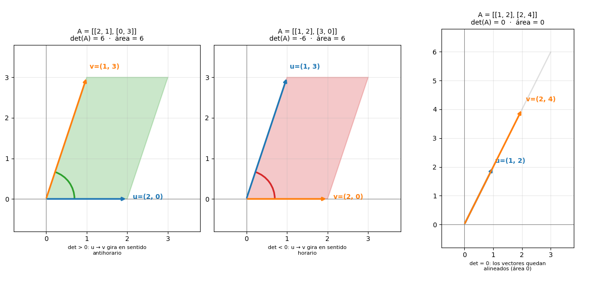

# 03-003: Matrices

***

## 3.4.     Determinante de una matriz

EL **determinante de una matriz es un valor escalar**, (un único número), calculado **a partir de una matriz cuadrada**.  

 - Se representa como $\det(A)$ o $|A|$.

> [!NOTE]
> La notación $|A|$ **no es un valor absoluto ni una norma**:  
>   - El determinante **puede ser negativo, cero, positivo**...  


El determinante condensa en un solo número información muy importante sobre la matriz:

-   Si la matriz **tiene, o no, inversa**
-   Cuánto **escala áreas o volúmenes** la transformación que representa
-   Si sus filas o columnas son **redundantes (dependientes entre sí mismas)**


***

### 3.4.1.1 ¿Por qué necesito comprender, resolver y usar el determinante de una matriz?  

* 1. **Saber si una matriz tiene inversa**
    - $A$ es invertible $\iff \det(A) \neq 0$ (ver 3.4.6)
    - Si $\det(A) = 0$, la matriz es **singular** y no existe $A^{-1}$

* 2. **Resolver sistemas de ecuaciones lineales**
    - $A\mathbf{x} = \mathbf{b}$ tiene **solución única** $\iff \det(A) \neq 0$ (ver 3.4.6)
    - Si $\det(A) = 0$, el sistema es **singular**: o no tiene solución, o tiene infinitas

* 3. **Geometría**
    - $|\det(A)|$ es el **factor de escala** de áreas (en $2 \times 2$) o volúmenes (en $3 \times 3$) que aplica la transformación (ver 3.4.3)
    - El **signo** indica si la transformación **invierte la orientación** (positivo: la conserva; negativo: la invierte)
    - $\det(A) = 0$ significa que la transformación **aplasta/colpasa** el espacio a una dimensión menor

* 4. **Detectar redundancia**
    - $\det(A) = 0$ $\iff$ las filas (o columnas) son **linealmente dependientes** entre sí (ver 3.4.6)
    - Es decir, si hay información repetida o derivable de las demás

* 5. **En álgebra lineal y ML**
    - Si las columnas de una matriz de datos $X$ son dependientes (variables redundantes), entonces $\det(X^T X) = 0$
    - En la práctica, para detectar redundancia se usan medidas más fiables que el determinante, como el **rango** (ver 3.4.7.7)


***


### 3.4.2.  Condición de Determinante: LA MATRIZ DEBE SER CUADRADA

> [!IMPORTANT]
> El determinante **solo está definido para matrices cuadradas**:  
>   - Aquella que tienen el **mismo número de filas que de columnas**, es decir, de forma $(n, n)$  

| Matriz       | Forma    | ¿Tiene determinante? |
| ------------ | -------- | -------------------- |
| $2 \times 2$ | `(2, 2)` | Sí                   |
| $3 \times 3$ | `(3, 3)` | Sí                   |
| $2 \times 3$ | `(2, 3)` | **No**               |
| $3 \times 1$ | `(3, 1)` | **No**               |

***


#### 3.4.2.1.    Determinante de una matriz $2 \times 2$

##### 3.4.2.1.1.  Fórmula

Para una matriz de $2 \times 2$:

$$
A =
\begin{pmatrix}
a & b \\
c & d
\end{pmatrix}
$$

Su determinante es:

$$
\det(A) = ad - bc
$$

Es decir, **el producto de la diagonal principal menos el producto de la diagonal secundaria**:

```text
  [ a, b ]  ↘  diagonal principal:   a * d   (se suma)
  [ c, d ]  ↙  diagonal secundaria:  b * c   (se resta)
```

> [!NOTE]
> La **diagonal principal** es la que ya conoces de la traspuesta:  
>   - Empieza en `[0, 0]`  
>  
> La **diagonal secundaria** es la que adquieres ahora:  
>   - Inverda a la diagonal primaria  
>   - Empieza en `[0, -1]`  

##### 3.4.2.1.2.    Ejemplo

$$
A =
\begin{pmatrix}
1 & 2 \\
3 & 4
\end{pmatrix}
$$

$$
\det(A) = (1 \cdot 4) - (2 \cdot 3) = 4 - 6 = \boxed{-2}
$$

> [!NOTE]
> Para una matriz $1 \times 1$, el determinante no tiene más opción que ser su único elemento:  
>   - $\det\big((a)\big) = a$

***

### 3.4.3. Interpretación geométrica - Visualización mental a través de la geometría

Cada columna de una matriz $2 \times 2$ es un **vector**:  
    - Llamémoslas $\mathbf{u}$ y $\mathbf{v}$.
    - Estos dos vectores... **ESTÁN FORMANDO UN PARALELOGRAMO!**


> [!IMPORTANT]
> El valor absoluto del determinante, $|\det(A)|$, es el **área del paralelogramo** formado por las columnas de $A$

Y el **signo** indica el sentido de giro de $\mathbf{u}$ a $\mathbf{v}$:

| $\det(A)$  | Significado                                              |
| ---------- | -------------------------------------------------------- |
| Positivo   | De $\mathbf{u}$ ... a $\mathbf{v}$, gira en sentido **antihorario** |
| Negativo   | De $\mathbf{u}$ ... a $\mathbf{v}$,  gira en sentido **horario**     |
| Cero       | Los vectores quedan **alineados**, el área es $0$        |



- **Caso 1:**   *determinante positivo*
    - $A = \begin{pmatrix} 2 & 1 \\ 0 & 3 \end{pmatrix}$  
    - Con $\mathbf{u} = (2, 0)$ y $\mathbf{v} = (1, 3)$  
    - Su determinante es $2 \cdot 3 - 1 \cdot 0 = 6$   
    - **Area $6$ y giro antihorario**  

- **Caso 2:** *determinante negativo (mismas columnas, intercambiadas)* 
    - $A = \begin{pmatrix} 1 & 2 \\ 3 & 0 \end{pmatrix}$  
    - El paralelogramo es el mismo (área $6$), pero el giro es horarip  
    - Por lo que su determinante es $\det(A) = -6$  

- **Caso 3:**   *determinante cero*
    - $A = \begin{pmatrix} 1 & 2 \\ 2 & 4 \end{pmatrix}$  
    - La segunda columna es el **doble** de la primera, así que los vectores están alineados  
    - Su determinante será $\det(A) = 1 \cdot 4 - 2 \cdot 2 = 0$  

> [!TIP]
> Una forma útil de visualizaro mentalmente:  
>    
>   - La matriz $A$ **transforma** el cuadrado unidad (de área $1$) en el paralelogramo de sus columnas.  
>   - Por eso $|\det(A)|$ es el **factor por el que la transformación multiplica las áreas**.  
>  
>   - En $3 \times 3$, el mismo razonamiento se aplica a **volúmenes**.

***


### 3.4.4. Determinante de una matriz $3 \times 3$ (REGLA DE SARRUS)

> [!WARNING]
> La regla de Sarrus **solo funciona para matrices $3 \times 3$**. No se puede extender a $4 \times 4$ ni a tamaños mayores.  

#### 3.4.4.1. Regla de Sarrus

Si estamos hablando de las regla de SArrus, estamos hablando de una matriz de $3 \times 3$:  

$$
A =
\begin{pmatrix}
a & b & c \\
d & e & f \\
g & h & i
\end{pmatrix}
$$

1.  Se **repiten las dos primeras columnas a la derecha** a la derecha
2.  Se **suman las tres diagonales descendentes**
3.  Se **restan las tres ascendentes**

```text
  [a  b  c]  a  b       ↘ se suman:  a*e*i,  b*f*g,  c*d*h
  [d  e  f]  d  e       ↙ se restan: c*e*g,  a*f*h,  b*d*i
  [g  h  i]  g  h
```

$$
\det(A) = aei + bfg + cdh - ceg - afh - bdi
$$

Ejemplo:

$$
A =
\begin{pmatrix}
2 & 0 & 1 \\
1 & 3 & 2 \\
1 & 1 & 4
\end{pmatrix}
$$

| Diagonales que se suman       | Producto                       | Diagonales que se restan      | Producto                       |
| ----------------------------- | ------------------------------ | ----------------------------- | ------------------------------ |
| $a \cdot e \cdot i$           | $2 \cdot 3 \cdot 4 = 24$       | $c \cdot e \cdot g$           | $1 \cdot 3 \cdot 1 = 3$        |
| $b \cdot f \cdot g$           | $0 \cdot 2 \cdot 1 = 0$        | $a \cdot f \cdot h$           | $2 \cdot 2 \cdot 1 = 4$        |
| $c \cdot d \cdot h$           | $1 \cdot 1 \cdot 1 = 1$        | $b \cdot d \cdot i$           | $0 \cdot 1 \cdot 4 = 0$        |
| **Total**                     | $25$                           | **Total**                     | $7$                            |

$$
\det(A) = 25 - 7 = \boxed{18}
$$

***


## 3.4.4.2. Desarrollo por cofactores (Laplace), para $n \times n$

El método de Sarrus solo sirve para $3 \times 3$. Para cualquier $n \times n$ existe un método **general y recursivo**:

1. Reducir el determinante $n \times n$ ...
2. ... a varios determinantes de $(n-1) \times (n-1)$ ...
3. ... hasta llegar al $2 \times 2$ !


Antes de la fórmula conviene definir algunos términos:

- **MENOR COMPLEMENTARIO / MENOR** $M_{ij}$
    -   El determinante resultante al **tachar la fila $i$ y la columna $j$**

- **COFACTOR / ADJUNTO** $C_{ij} = (-1)^{i+j}\,M_{ij}$
    -   El menor con el **factor de signo** ya aplicado

- **FACTOR DE SIGNO / SIGNO DEL COFACTOR** $(-1)^{i+j}$
    - Depende **solo de la posición $(i,j)$**, no del valor. 

Para visualizar mentalmente la alplicación del factor de signo al menor, podemos verlo  **como un tablero de ajedrez**:

```text
posición (i, j)
signo = (-1) ^ (i + j) 

     (j)
(i) [ +  -  +  - ]    fila 0:  +  -  +  -
    [ -  +  -  + ]    fila 1:  -  +  -  +
    [ +  -  +  - ]    fila 2:  +  -  +  -
    [ -  +  -  + ]    fila 3:  -  +  -  +

```

### 3.4.4.2.1.  Fórmula (desarrollo por la fila $i$)

$$
\det(A) = \sum_{j=0}^{n-1} a_{ij}\,C_{ij} = \sum_{j=0}^{n-1} (-1)^{i+j}\,a_{ij}\,M_{ij}
$$

Es decir, **cada elemento de la fila elegida multiplica a su cofactor, y se suman todos**.  

### 3.4.4.2.2. Caso $3 \times 3$ y ejemplo


Para $n=3$, desarrollando por la primera fila ($i=0$):  

$$
\det(A) = a_{00}M_{00} - a_{01}M_{01} + a_{02}M_{02}
$$

Cada $M_{0j}$ es un determinante $2 \times 2$. Con la matriz del ejemplo:  

$$
A = \begin{bmatrix} 
2 & 0 & 1 \\  
1 & 3 & 2 \\  
1 & 1 & 4 \end{bmatrix}
$$


Para visualizarlo mentalmente haremos las reducciones paso a paso visual:

1.  Dada la matriz:
```text
[2   0   1]
[1   3   2]
[1   1   4]
```

2. Generamos las matrices para tachar:  
    
    - Generamos $M_{00}$, $M_{01}$, $M_{02}$  
    
    - SIEMPRE FILA 0 TACHADA para todas $M_{0j}$  
        - Para $M_{00}$, $j_0$ tacha la primera columna  
        - Para $M_{01}$, $j_1$ tacha la segunda columna  
        - Para $M_{02}$, $j_2$ tacha la tercera columna  

```text
   j = 0              j = 1              j = 2
 [X  X  X]          [X  X  X]          [X  X  X]
 [X  3  2]          [1  X  2]          [1  3  X]
 [X  1  4]          [1  X  4]          [1  1  X]
```


3. Una vez tachadas, ya tenemos reducidas a $2 \times 2$ cada matriz:  
```text
M_00 =  [3 2]         
        [1 4]
                 
M_01 =  [1 2]
        [1 4]

M_02 =  [1 3]
        [1 1]
```

4. Aplicamos $\sum_{j=0}^{n-1} (-1)^{i+j}\,a_{ij}\,M_{ij}$ a cada matriz:
```text
M_00    =       [3 2]
                [1 4]
        =   3 * 4  -  2 * 1
        =   10                     

M_01    =       [1 2]
                [1 4]
        =   1 * 4  -  2 * 1
        =   2 

M_02    =       [1 3]
                [1 1]
        =   1 * 1  - 3 * 1
        =   -2
```

Sustituyendo en la fórmula (con los signos $+,-,+$ de la fila 0):  

$$
\begin{aligned}
\det(A) &= 2\cdot(10) - 0\cdot(2) + 1\cdot(-2) \\
&= 20 - 0 - 2 \\
&= \boxed{18}
\end{aligned}
$$

> [!TIP]
> Se puede desarrollar por **cualquier fila o columna**, pero conviene elegir la que tenga **más ceros**:  
>   - **Cada cero anula su término entero** (aquí, el $0$ de la primera fila elimina el segundo término)


### 3.4.4.2.3.  Casos grandes, $5 \times 5$:   Estrategia de "crear ceros"

Para $n \ge 4$ el desarrollo directo por cofactores **no es rentable**: 

- Un $5 \times 5$ genera cinco menores $4 \times 4$ ... 
- ... Cada uno de ellos genera cuatro $3 \times 3$ ...
- ... Cada uno de estos, a su vez, generan tres $2 \times 2$ ...
- ... y así sucesivamente, explotando en cálculos.


Es decir, el número de términos crece como $n!$, exponencialmente.

Para casos gigantes, a forma habitual de trabajar es:

1. **Usar operaciones elementales entre filas para crear ceros en una fila o columna determinada**
2. Y, después, desarrollar por esa línea.


> [!NOTE]
> Las operaciones elementales entre filas **no cambian el determinante** salvo que se intercambien filas (donde, en consecuencia, cambiaría el signo).  
>  
> En particular, sumar a una fila un múltiplo de otra **deja el determinante igual**.

Dada la siguiente $5 \times 5$:  

$$
A = \begin{pmatrix}
1 & 2 & 0 & 0 & 3 \\
0 & 1 & 4 & 0 & 0 \\
2 & 0 & 1 & 5 & 0 \\
0 & 3 & 0 & 1 & 2 \\
1 & 0 & 0 & 0 & 1
\end{pmatrix}
$$


1.  **CREAR CEROS EN LA PRIMERA COLUMNA**   
- Decidimos usar las la fila 1:  
    - Tiene un $1$ en la posición $(1,1)$)
    - Anulamos los valores que no sean ceros:
        - El $2$ de la fila 3, y el $1$ de la fila 5:    
            - $F_3 \leftarrow F_3 - 2F_1$ (anula el $2$ de $(3,1)$)  
            - $F_5 \leftarrow F_5 - F_1$ (anula el $1$ de $(5,1)$)  

$$
A' = \begin{pmatrix}
1 & 2 & 0 & 0 & 3 \\
0 & 1 & 4 & 0 & 0 \\
0 & -4 & 1 & 5 & -6 \\
0 & 3 & 0 & 1 & 2 \\
0 & -2 & 0 & 0 & -2
\end{pmatrix}
$$


2. **DESARROLLAR POR LA PRIMERA COLUMNA** 

- Solo queda el término $a_{11}=1$, con signo $(-1)^{1+1}=+$:

$$
\det(A) = 1 \cdot \det\begin{pmatrix}
1 & 4 & 0 & 0 \\
-4 & 1 & 5 & -6 \\
3 & 0 & 1 & 2 \\
-2 & 0 & 0 & -2
\end{pmatrix}
$$


3.  **CREAR CEROS en la PRIMERA COLUMNA DEL $(n-1) \times (n-1)$ inmediatamente inferior**  
- En este caso, en columna del $4 \times 4$.
- Usamos la fila 1 ($1$ en $(1,1)$) para anular el $-4$ y el $3$:

    - $F_2 \leftarrow F_2 + 4F_1$
    - $F_3 \leftarrow F_3 - 3F_1$

$$
\det = \det\begin{pmatrix}
1 & 4 & 0 & 0 \\
0 & 17 & 5 & -6 \\
0 & -12 & 1 & 2 \\
-2 & 0 & 0 & -2
\end{pmatrix}
$$

4. **SEGUIR DESARROLLANDO a $n-1$**
- Ya hay dos ceros en la primera columna, pero el $-2$ de la fila 4 sigue ahí, por lo que podemos... :
    - O bien desarrollar por la primera columna (dos términos)
    - O bien crear un cero más con $F_4 \leftarrow F_4 + 2F_1$:

$$
\det = \det\begin{pmatrix}
1 & 4 & 0 & 0 \\
0 & 17 & 5 & -6 \\
0 & -12 & 1 & 2 \\
0 & 8 & 0 & -2
\end{pmatrix}
= 1 \cdot \det\begin{pmatrix}
17 & 5 & -6 \\
-12 & 1 & 2 \\
8 & 0 & -2
\end{pmatrix}
$$

5.  **LLEGAMOS a $3 \times 3$, Sarrus o cofactores**
- Este $3 \times 3$ ya se resuelve directamente:

$$
\begin{aligned}
\det\begin{pmatrix}
17 & 5 & -6 \\
-12 & 1 & 2 \\
8 & 0 & -2
\end{pmatrix}
&= 17\cdot1\cdot(-2) + 5\cdot2\cdot8 + (-6)\cdot(-12)\cdot0 \\
&\quad - (-6)\cdot1\cdot8 - 17\cdot2\cdot0 - 5\cdot(-12)\cdot(-2) \\
&= -34 + 80 + 0 - (-48) - 0 - 120 \\
&= -34 + 80 + 48 - 120 \\
&= \boxed{-26}
\end{aligned}
$$

$$
\begin{aligned}
\det(A) = \boxed{-26}
\end{aligned}
$$


> [!NOTE]
> **El patrón es claro:** en cada paso elegimos la fila/columna con más ceros y creamos más ceros con operaciones entre filas. Así, el número de términos que hay que arrastrar se mantiene pequeño.
>
> En este ejemplo concreto, el desarrollo directo del $5 \times 5$ habría requerido:     
>   1. Evaluar 5 menores $4 \times 4$ ...    
>   2. Cada uno de estos, evaluar 4 menores $3 \times 3$ cada uno de estos ...  
>   3. 3 menores $2 \times 2$...  
>   Y así sucesiva y recursivamente, lo que no es nada rentable en términos de cálculo.    
>   En total, **cientos de determinantes** frente a los **6 pasos** que acabamos de dar.  


### 3.4.4.2.4. Estrategia práctica

Para $n\ge4$ **no conviene desarrollar directamente por cofactores**: el coste crece como $n!$.  

El procedimiento habitual es:

1. **Crear ceros** con operaciones elementales entre filas (sumar múltiplos de otra fila no cambia el determinante; intercambiar filas cambia el signo).
2. **Desarrollar por la fila o columna con más ceros**, reduciendo el orden en 1.
3. **Repetir** hasta llegar a $3 \times 3$ (Sarrus) o $2 \times 2$ (fórmula directa).

> [!NOTE]
> Para un $4 \times 4$ o mayor, el método **más eficiente** no es Laplace sino la **ELIMINACIÓN GAUSSIANA** (descomposición Lower-Upper, matrices triangulares), de orden $n^3$.  
> 
> Laplace se estudia porque es la **definición recursiva** del determinante y porque permite demostrar propiedades; en cálculo numérico se usa Descomposición LU, en el caso de las matrices triangulares que viene a continuación.  


***


#### 3.4.4.3. El fascinante mundo de las MATRICES TRIANGULARES

Una **matriz triangular** es aquella en la que todos los elementos a un lado de una de las diagonales son **cero**.  
    - Los elementos no nulos forman un "triángulo" al otro lado de la diagonal.

Hay **dos familias**, según la diagonal sobre la que se construye el triángulo:  

1. **Triangular Principal (o simplemente triangular)**  
    - El triángulo se construye sobre la **diagonal principal**

2. **Triangular Secundaria (o Antidiagonal)**
    - El triángulo se construye sobre la **diagonal secundaria**


Y, dentro de cada familia, **dos subtipos**, según hacia dónde mire el triángulo:

| Familia | Subtipo | Dónde están los ceros | Nombre habitual |
|---|---|---|---|
| Principal | Superior | **Por debajo** de la diagonal principal | Triangular superior ($U$) |
| Principal | Inferior | **Por encima** de la diagonal principal | Triangular inferior ($L$) |
| Secundaria | Superior | **Por debajo** de la diagonal secundaria | Triangular secundaria superior |
| Secundaria | Inferior | **Por encima** de la diagonal secundaria | Triangular secundaria inferior |

> [!NOTE]
> La nomenclatura "superior/inferior" es habitual, y refiere a **dónde queda el triángulo de datos no nulos**, no a la ubicación de los ceros.  


  
##### 3.4.4.3.1. Triangulares principales (sobre la diagonal principal)

1.  **Triangular superior ($U$):**      *ceros por debajo de la diagonal principal, datos arriba*          

$$
U = \begin{pmatrix}
\mathbf{2} & 1 & 3 \\
0 & \mathbf{4} & 1 \\
0 & 0 & \mathbf{5}
\end{pmatrix}
\quad\Longrightarrow\quad
\det(U) = 2 \cdot 4 \cdot 5 = \boxed{40}
$$

2.  **Triangular inferior ($L$):**      *ceros por encima de la diagonal principal, datos abajo*      

$$
L = \begin{pmatrix}
\mathbf{5} & 0 & 0 \\
2 & \mathbf{8} & 0 \\
1 & 9 & \mathbf{3}
\end{pmatrix}
\quad\Longrightarrow\quad
\det(L) = 5 \cdot 8 \cdot 3 = \boxed{120}
$$

> [!TIP]
> **FUNDAMENTAL PARA TRIANGULAR PRINCIPAL**:  
>   
>   - Más adelante, al desarrollar por Laplace, casi todos los términos colapsan, y el determinante de **cualquier matriz triangular principal** (superior o inferior) es simplemente el **producto de los elementos de su diagonal principal**. Memorízalo.  


##### 3.4.4.3.2. Triangulares secundarias (sobre la diagonal secundaria)

La **diagonal secundaria** (o antidiagonal) va de la esquina superior derecha a la inferior izquierda.  
Y, sobre ella se construyen los otros dos subtipos:  


3.  **Triangular secundaria superior:**     *ceros por debajo de la diagonal secundaria, datos arriba*  

$$
U_s = \begin{pmatrix}
0 & 0 & \mathbf{3} \\
0 & \mathbf{4} & 2 \\
\mathbf{5} & 6 & 1
\end{pmatrix}
$$


4.  **Triangular secundaria inferior:**     *ceros por encima de la diagonal secundaria, datos abajo*  

$$
L_s = \begin{pmatrix}
1 & 2 & \mathbf{3} \\
4 & \mathbf{5} & 0 \\
\mathbf{6} & 0 & 0
\end{pmatrix}
$$

> [!IMPORTANT]
> **FUNDAMENTAL PARA TRIANGULAR SECUNDARIA**  
>  
>   - El determinante es el **producto de los elementos de la diagonal secundaria**, multiplicado por un signo $(\pm 1)$ que depende del tamaño $n \times n$.  
>   
>   - El signo aparece porque, para llevar la matriz a forma triangular principal, hay que **permutar filas** (o columnas), y cada permutación cambia el signo del determinante.
>
>   - En concreto, el signo es $(-1)^{\lfloor n/2 \rfloor}$:
>   
>       - $n = 2$: signo $(-1)^1 = -1$
>       - $n = 3$: signo $(-1)^1 = -1$
>       - $n = 4$: signo $(-1)^2 = +1$
>       - $n = 5$: signo $(-1)^2 = +1$


##### 3.4.4.3.3. **Comprobación con los ejemplos $3 \times 3$ anteriores** (producto de la diagonal secundaria, con signo $-1$ para $n=3$)

1. Para $U_s$:  
    - La diagonal secundaria es $(3, 4, 5)$
    - Producto $3 \cdot 4 \cdot 5 = 60$  
    - Con signo $(-1)^{\lfloor 3/2 \rfloor} = (-1)^1 = -1$  
        * $$\det(U_s) = -60$$

2. Para $L_s$:  
    - La diagonal secundaria es $(3, 5, 6)$
    - Producto $3 \cdot 5 \cdot 6 = 90$
    - Con el mismo signo
        * $$\det(L_s) = -90$$

> [!NOTE]
> **¿Por qué el signo depende solo del tamaño de $n$?** 
>   
>   - Una vez más... porque, para llevar una triangular secundaria a triangular principal, hay que invertir el orden de las filas (o de las columnas)  
>   - Invertir $n$ elementos requiere $\lfloor n/2 \rfloor$ intercambios, y cada intercambio multiplica el determinante por $-1$. De ahí $(-1)^{\lfloor n/2 \rfloor}$  


##### 3.4.4.3.4.    Visualizar mentalmente las diagonales

```text
Datos = 💵  Cero = 0️⃣   

                DIAGONAL PRINCIPAL = ⭐       DIAGONAL SECUNDARIA = ☄️

SUPERIOR            [⭐ 💵 💵]                     [0️⃣ 0️⃣ ☄️]
(datos arriba,      [0️⃣ ⭐ 💵]                     [0️⃣ ☄️ 💵]
 ceros abajo)       [0️⃣ 0️⃣ ⭐]                     [☄️ 💵 💵]

Determinante =  Producto Diagonal Principal     Determinante =  Producto Diagonal Secundaria


INFERIOR            [⭐ 0️⃣ 0️⃣]                     [💵 💵 ☄️]
(datos abajo,       [💵 ⭐ 0️⃣]                     [💵 ☄️ 0️⃣]
 ceros arriba)      [💵 💵 ⭐]                     [☄️ 0️⃣ 0️⃣]

Determinante = Producto diagonal Principal      Determinante =  Producto Diagonal Secundaria
```


***

### 3.4.5. Propiedades básicas del determinante de una matriz

| # | Propiedad | Fórmula |
|---|---|---|
| 1 | Matriz identidad | $\det(I) = 1$ |
| 2 | Traspuesta | $\det(A^T) = \det(A)$ |
| 3 | Producto de matrices | $\det(AB) = \det(A) \cdot \det(B)$ |
| 4 | Multiplicar por un escalar (matriz $n \times n$) | $\det(kA) = k^n \cdot \det(A)$ |
| 5 | Intercambiar dos filas (o dos columnas) | El determinante **cambia de signo** |
| 6 | Fila (o columna) de ceros | $\det(A) = 0$ |
| 7 | Dos filas (o columnas) iguales o proporcionales | $\det(A) = 0$ |
| 8 | La suma no se comporta igual | $\det(A + B) \neq \det(A) + \det(B)$ |
| 9 | Matriz triangular principal (superior o inferior) | **Producto de su diagonal principal** |
| 10 | Matriz triangular secundaria (superior o inferior) | **Producto de su diagonal secundaria**, con signo $(\pm 1)$ según $n$ |


> [!IMPORTANT]
> Dadas estas dos matrices, desarrollemos cada propiedad:

$$
A = \begin{pmatrix} 1 & 2 \\ 3 & 4 \end{pmatrix}, \quad \det(A) = -2
\qquad
B = \begin{pmatrix} 2 & 0 \\ 1 & 3 \end{pmatrix}, \quad \det(B) = 6
$$

---

**1. Matriz identidad: $\det(I) = 1$**

$$
I = \begin{pmatrix} 1 & 0 \\ 0 & 1 \end{pmatrix}
\qquad\Longrightarrow\qquad
\det(I) = 1 \cdot 1 - 0 \cdot 0 = 1
$$

> *"El determinante de la matriz identidad es siempre 1, sea cual sea el orden."*

---

**2. Traspuesta: $\det(A^T) = \det(A)$**

$$
A^T = \begin{pmatrix} 1 & 3 \\ 2 & 4 \end{pmatrix}
\qquad\Longrightarrow\qquad
\det(A^T) = 1 \cdot 4 - 3 \cdot 2 = -2 = \det(A)
$$

> *"El determinante de una matriz cuadrada coincide con el determinante de su traspuesta, ya que al cambiar las filas por las columnas los productos quedan iguales y con igual signo."* 

---

**3. Producto de matrices: $\det(AB) = \det(A) \cdot \det(B)$**

$$
AB = \begin{pmatrix} 1 & 2 \\ 3 & 4 \end{pmatrix}\begin{pmatrix} 2 & 0 \\ 1 & 3 \end{pmatrix}
= \begin{pmatrix} 4 & 6 \\ 10 & 12 \end{pmatrix}
\qquad\Longrightarrow\qquad
\det(AB) = 48 - 60 = -12 = (-2) \cdot 6
$$

> *"El determinante del producto es igual al producto de los determinantes."* 

> [!WARNING]
> En NumPy, `A @ B` es el producto matricial (cumple esta propiedad). `A * B` es **elemento a elemento** (Hadamard) y **no** la cumple.

---

**4. Escalar × matriz: $\det(kA) = k^n \det(A)$, con $n = 2$**

$$
3A = \begin{pmatrix} 3 & 6 \\ 9 & 12 \end{pmatrix}
\qquad\Longrightarrow\qquad
\det(3A) = 3 \cdot 12 - 6 \cdot 9 = -18 = 3^2 \cdot (-2)
$$

> *"Al multiplicar una matriz por un número, por cada fila sale ese número fuera del determinante. Si la matriz tiene $n$ filas, el número sale $n$ veces: $\det(kA) = k^n \det(A)$."* 

---

**5. Intercambiar filas: el determinante cambia de signo**

$$
A = \begin{pmatrix} 1 & 2 \\ 3 & 4 \end{pmatrix}, \quad \det(A) = -2
\qquad\Longrightarrow\qquad
A' = \begin{pmatrix} 3 & 4 \\ 1 & 2 \end{pmatrix}, \quad \det(A') = +2
$$

> *"Al intercambiar dos líneas paralelas (filas o columnas) de una matriz, el determinante cambia de signo, pero no varía su valor absoluto."* 

---

**6. Fila (o columna) de ceros: $\det(A) = 0$**

$$
\begin{pmatrix} 1 & 2 \\ 0 & 0 \end{pmatrix}
\qquad\Longrightarrow\qquad
\det = 1 \cdot 0 - 2 \cdot 0 = 0
$$

> *"Si una fila o columna es toda de ceros, el determinante vale cero, porque todos los productos contienen un factor nulo."*

---

**7. Dos filas iguales o proporcionales: $\det(A) = 0$**

$$
\begin{pmatrix} 1 & 2 \\ 2 & 4 \end{pmatrix}
\qquad\Longrightarrow\qquad
\det = 1 \cdot 4 - 2 \cdot 2 = 0
\qquad\text{(la 2ª fila es el doble de la 1ª)}
$$

---

> *"Un determinante que tiene dos filas o dos columnas idénticas es nulo. Y si son proporcionales, también, porque sacando el factor común quedan dos líneas iguales."* 

**8. La suma NO se comporta igual: $\det(A+B) \neq \det(A) + \det(B)$**

$$
A + B = \begin{pmatrix} 3 & 2 \\ 4 & 7 \end{pmatrix}
\qquad\Longrightarrow\qquad
\det(A+B) = 21 - 8 = 13 \neq -2 + 6 = 4
$$

> *"El determinante no es lineal respecto de la suma de matrices: en general, $\det(A+B)$ no es $\det(A)+\det(B)$."*

---

**9. Triangular principal: producto de la diagonal principal**

$$
U = \begin{pmatrix} 2 & 1 & 3 \\ 0 & 4 & 1 \\ 0 & 0 & 5 \end{pmatrix}
\qquad\Longrightarrow\qquad
\det(U) = 2 \cdot 4 \cdot 5 = 40
$$

$$
L = \begin{pmatrix} 5 & 0 & 0 \\ 2 & 8 & 0 \\ 1 & 9 & 3 \end{pmatrix}
\qquad\Longrightarrow\qquad
\det(L) = 5 \cdot 8 \cdot 3 = 120
$$

> *"El determinante de una matriz triangular es el producto de los elementos de su diagonal principal."*


---

**10. Triangular secundaria: producto de la diagonal secundaria, con signo $(-1)^{\lfloor n/2 \rfloor}$**

$$
U_s = \begin{pmatrix} 0 & 0 & 3 \\ 0 & 4 & 2 \\ 5 & 6 & 1 \end{pmatrix}
\qquad\Longrightarrow\qquad
\det(U_s) = (-1)^{\lfloor 3/2 \rfloor} \cdot (3 \cdot 4 \cdot 5) = -60
$$

$$
L_s = \begin{pmatrix} 1 & 2 & 3 \\ 4 & 5 & 0 \\ 6 & 0 & 0 \end{pmatrix}
\qquad\Longrightarrow\qquad
\det(L_s) = (-1)^{\lfloor 3/2 \rfloor} \cdot (3 \cdot 5 \cdot 6) = -90
$$

> *"Si los ceros están sobre la diagonal secundaria, el determinante es el producto de esa diagonal, con el signo que corresponda según el número de permutaciones necesarias."*


---

### 3.4.6.  Matriz Singular, *¿Qué significa que el determinante sea cero?*


Un determinante cero indica que **las filas (o columnas) son dependientes**:  

-   Alguna se puede obtener combinando las demás  
-   Geométricamente, el paralelogramo (o el volumen en $3 \times 3$) **se aplasta/colapsa**, y su área se vuelve cero
-   **NO tiene inversa**

| $\det(A)$            | La matriz es ..                    | Consecuencia                                      |
| -------------------- | ---------------------------------- | ------------------------------------------------- |
| **Distinto de cero** | **Regular** (invertible)           | **Tiene inversa**                                 |
| **Igual a cero**     | **Singular** (no invertible)       | **No tiene inversa**                              |


Un caso clásico:

$$
S =
\begin{pmatrix}
1 & 2 & 3 \\
4 & 5 & 6 \\
7 & 8 & 9
\end{pmatrix}
$$

La tercera fila se obtiene a partir de las otras dos:  
    - $2 \cdot (4, 5, 6) - (1, 2, 3) = (7, 8, 9)$  
    - Por tanto, $\det(S) = 0$  (la matriz SI es **singular**)  

> [!IMPORTANT]
> Para una matriz cuadrada $A$, un sistema $A\mathbf{x} = \mathbf{b}$ tiene **solución única** si y solo si $\det(A) \neq 0$.

---

### 3.4.7. Determinantes en NumPy

> [!IMPORTANT]
> **Nuevos métodos que añadimos a nuestra colección!**  
>   
> - `np.linalg.det(M)`: *calcula el* ***determinante*** *de una matriz cuadrada `M`*  
>       * Devuelve un `float`, aunque `M` sea de enteros (por eso el resultado es aproximado)  
>       * Lanza `LinAlgError` si `M` no es cuadrada  
>   
> - `np.diag(M)`: *tiene* ***dos caras*** *según lo que reciba*  
>       * Con una **matriz 2D**, **extrae** su diagonal principal como vector 1D  
>       * Con un **vector 1D**, **construye** una matriz diagonal a partir de él  
>   
> - `np.isclose(a, b)`: *compara dos números de manera fiable (no como con `==`)*  
>       * Devuelve `True` si están "suficientemente cerca"  
>       * Necesario porque los cálculos floats (casi) nunca dan el valor exacto  


#### 3.4.7.1. `np.linalg.det()`

Con NumPy utilizamos `np.linalg.det(A)`:  

```python
A = np.array([
    [1, 2],
    [3, 4]
])

determinante = np.linalg.det(A)

print(determinante)        # -2.0000000000000004
print(type(determinante))  # <class 'numpy.float64'>
```

> [!NOTE]
> Aunque la matriz sea de enteros, **el resultado SIEMPRE es un `float`**, y por tanto **aproximado**.  
> Por ello, hay distintos métodos para recabar o compara determinantes, trabajando en floats, con escalas muy amplias, etc.


#### 3.4.7.2.   `np.isclose()`,  comparando resultados en coma flotante: 

NumPy, que trabaja con números en **coma flotante**, puede dar determinantes con pequeños errores de redondeo. Por eso, como vimos en vectores y al comienzo de matrices, **NUNCA se hace una comparación directa `==`**.  

Para ello, `np.isclose(valor, objetivo)` "alisa" los coma-flotantes para hacer las comparaciones de la forma adecuada:  

```python
print(determinante == -2)            # False
print(np.isclose(determinante, -2))  # True
```

Lo mismo ocurre al comprobar si un determinante es **prácticamente cero**:

```python
S = np.array([
    [1, 2, 3],
    [4, 5, 6],
    [7, 8, 9]
])

d = np.linalg.det(S)

print(d)                 # 6.66133814775094e-16
print(np.isclose(d, 0))  # True
```

> [!TIP]
> Existen varios enfoques para portar los valores en notación ciéntifica (que ocurrirá siempre con las matrices singulares, determinantes cero) a valores visualmente asimilados:  
>   1. El primero, adaptarse a usar notación científica. Un `6.66133814775094e-16` ya te está hablando de la tolerancia, diciendo que tiene muuuuchos ceros por delante en los decimales (`0.00000000000000000066133814...`, $10^{-16}$ ), viendo que **APARENTEMENTE es una singular, determinante cero** (aparentemente ...).  
>   2. Redondear con `round(determinante, decimales)`
>   3. Configurar NumPy nada más importarlo para que muestre los componentes de arrays tal y como tú le indiques, `np.set_printoptions(suppress=True, precision=4)` ... y, después, mostrando el determinante dentro de un array, `np.array( np.linalg.det(matriz) )`
>   4. Interpolar string siempre que NO necesites usar el valor numérico después,  `f"{determinante:.xf}"` (usando x como decimales deseados)
>  
> **Lo más adecuado es adaptarse a la notación científica; a efectos de el determinante de una matriz no es primordial extraer el valor exacto si sabes que es singular - cero - cerana a cero** (o sí, como veremos más adelante, usamos otros métodos para determinar la singularidad, o no, de una matriz).  


> [!WARNING]
> Por el mismo motivo, conviene entender que Python puede darte el mismo valor matemático usando tipos distintos:  
>   - `float`: $\det(A)$ y $\det(A^T)$ son iguales, pero NumPy puede darlos con **diferencias en las últimas cifras**  
>   - `np.isclose()` nos sirve de ayuda  

```python
print(np.linalg.det(A))    # -2.0000000000000004
print(np.linalg.det(A.T))  # -2.0
print(np.linalg.det(A) == np.linalg.det(A.T))             # False
print(np.isclose(np.linalg.det(A), np.linalg.det(A.T)))   # True
```


#### 3.4.7.3.   Comprobación manual, deconstrucción paso a paso

**Matriz $2 \times 2$**, con la fórmula $ad - bc$:  

```python
a, b = A[0]
c, d = A[1]

det_manual = a * d - b * c

print(det_manual)                                   # -2 (entero exacto)
print(np.isclose(det_manual, np.linalg.det(A)))     # True
```

**Matriz $3 \times 3$**, con la regla de Sarrus:  

```python
P = np.array([
    [2, 0, 1],
    [1, 3, 2],
    [1, 1, 4]
])

a, b, c = P[0]
d, e, f = P[1]
g, h, i = P[2]

positivos = a * e * i + b * f * g + c * d * h  # 25
negativos = c * e * g + a * f * h + b * d * i  # 7

determinante_sarrus = positivos - negativos

print(determinante_sarrus)                # 18
print(np.linalg.det(P))          # 17.999999999999996
print(np.isclose(determinante_sarrus, np.linalg.det(P)))  # True

# Para visualizar en Python la fórmula matemática exacta real, aunque sea dar un paso más
aei = a * e * i
bfg = b * f *g
cdh = c * d * h

ceg = c * e * g
afh = a * f * h
bdi = b * d * i

positivos_negativos_en_serie_es_la_determinante_literal = aei + bfg + cdh - ceg - afh - bdi

print(positivos_negativos_en_serie_es_la_determinante_literal)
print(np.isclose(positivos_negativos_en_serie_es_la_determinante_literal, determinante_sarrus))
```

> [!NOTE]
> El cálculo manual con enteros da **exactamente** `-2` y `18`; NumPy da valores **aproximados**. Ambos son correctos: la diferencia es solo de redondeo.


#### 3.4.7.4.   `LinAlgError`:  Si la matriz no es cuadrada

NumPy lanza un error:

```python
M = np.array([
    [1, 2, 3],
    [4, 5, 6]
])

print(M.shape)  # (2, 3)
# np.linalg.det(M)  # LinAlgError: Last 2 dimensions of the array must be square
```

> [!TIP]
> Antes de calcular, comprueba que la matriz es cuadrada: `M.shape[0] == M.shape[1]`.  
> Añade una condición-salvaguarda para este caso en aquellos programas que no quieres que se detengan por este motivo.


#### 3.4.7.5. Verificando las propiedades

```python
A = np.array([ 
    [1, 2],
    [3, 4] 
])

B = np.array([
    [2, 0],
    [1, 3]
])

# det(A^T) = det(A)
print(np.isclose(np.linalg.det(A.T), np.linalg.det(A)))                       # True

# det(AB) = det(A) * det(B)
print(np.isclose(np.linalg.det(A @ B), np.linalg.det(A) * np.linalg.det(B)))  # True

# det(kA) = k^n · det(A), con n = 2
print(np.isclose(np.linalg.det(3 * A), 3**2 * np.linalg.det(A)))              # True

# Intercambiar filas cambia el signo
print(np.isclose(np.linalg.det(A[::-1]), -np.linalg.det(A)))                  # True

# La suma NO se cumple
print(np.isclose(np.linalg.det(A + B), np.linalg.det(A) + np.linalg.det(B)))  # False
```


Y la propiedad de la matriz triangular principal superior, con `np.diag()` y `np.prod()`:

```python
U = np.array([
    [2, 1, 3],
    [0, 4, 1],
    [0, 0, 5]
])

print(np.prod(np.diag(U)))  # 40
print(np.linalg.det(U))     # 39.99999999999998 (≈ 40)
```

##### 3.4.7.5.1. Un apunte al fascinante mundo de las matrices triangulares

> [!IMPORTANT]
> **Nuevo método que añadimos a nuestra colección!**:       `np.fliplr(M)`  (y `np.flipud(M)`)
>
>   - Invierte el orden de las **columnas** de `M` (espejo horizontal)  
>   - Es la forma de poder "girar" la matriz para que la **diagonal secundaria** pase a ser como diagonal principal, y así poder extraerla con `np.diag`  
>       * Para el flip up-down, **invertir las filas** (espejo vertical) está `np.flipud(M)`-
>       * Muy útil para trabajar con triangulares secundarias, como veremos a continuación.

- `np.diag(M)` extrae la **diagonal principal** de `M` 
    - Para una **triangular principal** (superior o inferior), `np.prod(np.diag(M))` da directamente su determinante (sin signos ni permutaciones) 

- Para una **triangular secundaria**, `np.diag` **NO** da la diagonal relevante (da la principal, que está mezclada con ceros y datos)  
    - Hay que **girar** la matriz primero con `np.fliplr(M)`, y entonces `np.diag(np.fliplr(M))` sí devuelve la diagonal secundaria  
    - El determinante es `np.prod(np.diag(np.fliplr(M)))`, multiplicado por el signo $(-1)^{\lfloor n/2 \rfloor}$ (el que vimos en 3.4.4.3.2)  


Ejemplo con las dos triangulares secundarias de 3.4.4.3.2:

```python
U_s = np.array([
    [0, 0, 3],
    [0, 4, 2],
    [5, 6, 1]
])

L_s = np.array([
    [1, 2, 3],
    [4, 5, 0],
    [6, 0, 0]
])

# np.diag directo da la diagonal PRINCIPAL
print(np.diag(U_s))              # [0 4 1]   <- mezcla de ceros y datos
print(np.diag(L_s))              # [1 5 0]   <- mezcla de ceros y datos

# Girando con np.fliplr(), la diagonal secundaria pasa a ser la principal
print(np.diag( np.fliplr(U_s) ))   # [3 4 5]   <- diagonal secundaria de U_s
print(np.diag (np.fliplr(L_s) ))   # [3 5 6]   <- diagonal secundaria de L_s


# Determinante = producto de la diagonal secundaria * signo (-1)^(n//2), con n = 3
signo = (-1) ** (3 // 2)         # -1
print(signo * np.prod( np.diag( np.fliplr(U_s) ) ))   # -60
print(signo * np.prod( np.diag( np.fliplr(L_s) ) ))   # -90


# Comprobación con np.linalg.det()
print(np.linalg.det(U_s))        # -59.99999999999999  (≈ -60)
print(np.linalg.det(L_s))        # -90.0
```

- **La descomposición LU** (que trabajaremos más adelante) factoriza una matriz como $A = LU$, con $L$ triangular inferior y $U$ triangular superior:  
    - Por la propiedad del producto, $\det(A) = \det(L)\det(U)$, y cada uno es el producto de su diagonal  
    - De ahí que LU sea $O(n^3)$ (no hay que desarrollar cofactores, solo multiplicar diagonales)  


***


#### 3.4.7.6.   Laplace - Implementación manual por cofactores

> [!IMPORTANT]
> **Otro nuevo método desbloqueado!**:    `np.delete(matriz, posicion, axis=eje)`  
>  
> Compatibilísima con `np.vstack()` / `np.hstack()` (las que añaden una serie vertical (fila) u horizontal (columna)  voluntad).

```python
M = np.array([[10, 2, 3], [4, 5, 6]])
print(M)

# AÑADE UNA SERIE VERTICAL (fila), tres componentes
M = np.vstack( ( M, np.ones(3, dtype=int) ) )
print(M)

# AÑADE OTRA SERIE VERTICAL (fila), tres componentes
M = np.vstack( ( M, np.zeros(3, dtype=int) ) )
print(M)

"""
[[10  2  3]
 [ 4  5  6]
 [ 1  1  1]
 [ 0  0  0]]
"""

# ELIMINA, del EJE 0 (filas) la serie 3 (cuarta)
M = np.delete(M, -1, axis=0)
print(M)
"""
[[10  2  3]
 [ 4  5  6]
 [ 1  1  1]]
"""

# ELIMINA, del EJE 0 (filas) la serie 2 (tercera)
M = np.delete(M, 2, axis=0)
print(M)
"""
[[10  2  3]
 [ 4  5  6]]
"""
```


Ahora, para el desarrollo manual por cofactores, recursivos, vamos a hacerlo con su propia clase y método.  

- Traducimos la fórmula $\det(A)=\sum_j (-1)^{0+j} a_{0j} M_{0j}$ (desarrollo por la **primera fila**) a una función **recursiva**:
    * Un caso general que llama a la misma función con matrices más pequeñas
    * Dos casos base donde la recursión se detiene


```python
class DeterminanteManual:
    """Calcula el determinante por desarrollo de cofactores (primera fila)"""

    @staticmethod
    def calcular(matriz):
        
        matriz = np.asarray(matriz)

        condicion_dim = matriz.ndim != 2
        condicion_cuadrada = matriz.shape[0] != matriz.shape[1]

        if condicion_dim:
            print("No es viable la matriz NO es bidimensional!")
            return False
        if condicion_cuadrada:
            print("No es viable, la matriz NO es cuadrada!")
            return False


        n = matriz.shape[0]

        if n == 1:
            return matriz[0, 0]
        
        if n == 2:
            return matriz[0, 0] * matriz[1, 1] - matriz[0, 1] * matriz[1, 0]

        total = 0

        for j in range(n):
            
            menor = np.delete(np.delete(matriz, 0, axis=0), j, axis=1)  # tacha fila 0 y columna j
            signo = (-1) ** j                                      # signos alternos
            
            total += signo * matriz[0, j] * DeterminanteManual.calcular(menor)

        return total


        
# PARTE 1, usar los métodos vstack, hstack y delete citados
A = np.array([ [1, 2], [3, 4] ])
P = np.array([ [2, 0, 1], [1, 3, 2], [1, 1, 4] ])
S = np.array([ [1, 2, 3], [4, 5, 6], [7, 8, 9] ])
U = np.array([ [2, 1, 3], [0, 4, 1], [0, 0, 5] ])


M = np.array([[10, 2, 3], [4, 5, 6]])
M_original = M.copy()


print(M)
M = np.vstack( ( M, np.ones(3, dtype=int) ) )
print(M)
M = np.vstack( ( M, np.zeros(3, dtype=int) ) )
print(M)
M = np.delete(M, 3, axis=0)
print(M)
M = np.delete(M, -1, axis=0)
print(M)


print(DeterminanteManual.calcular(A))  # -2
print(DeterminanteManual.calcular(P))  # 18
print(DeterminanteManual.calcular(S))  # 0  (exactamente, sin error de redondeo)
print(DeterminanteManual.calcular(U))  # 40
print(DeterminanteManual.calcular(M))  # -9
print(DeterminanteManual.calcular(M_original))  # La salvaguarda explítica de matriz cuadrada salta "No es viable, la matriz NO es cuadrada!"
```

> [!IMPORTANT]
> Con matrices de enteros, este cálculo es **exacto**:  
>   - Para $S$ da `0`, mientras que NumPy puede dar un valor minúsculo.  
>  
>  Pero esto **NO se usa en la práctica**: el desarrollo por cofactores crece con $n!$ operaciones, y con NumPy tenemos métodos mucho más eficiente (como la citada descomposición LU con matrices triangulaes, del orden de $n^3$).

> [!NOTE]
> Ciertas decisiones de código, se implemntan tal cual para tratar de simplificar y mejorar la visualización en terminal.


***

#### 3.4.7.7. Un determinante pequeño NO siempre significa ser matriz singular

> [!IMPORTANT]
> **Nuevos métodos que añadimos a nuestra colección:**  
>  
> - `np.isclose(a, b, rtol=, atol=)`, que ahora recibe un nuevo **poder para manejar tolerancias en comparaciones**  
>       * **Compara dos números con tolerancia** (por defecto `rtol=1e-5`, `atol=1e-8`)  
>       * Devuelve `True` si se cumple:
>         $$|a - b| \le \text{atol} + \text{rtol} \cdot |b|$$  
>       * `atol=` es la **tolerancia absoluta**, el margen en las mismas unidades que `a` y `b`  
>           - Es la que **"manda" cuando comparamos contra cero**, porque `rtol * |0| = 0` y el término relativo desaparece  
>       * `rtol=` es la **tolerancia relativa**, un margen proporcional a $|b|$  
>           -  Es la que **"manda" cuando comparamos valores grandes** que deberían coincidir, donde un `atol` fijo sería demasiado estricto  
>       * **Útiles para comparar los determinantes con tolerancias, pero para definir la singularidad en estos casos conviene usar `np.linalg.matrix_rank(M)`**  
>           - *(Como se indica anteriormente, hay muchos enfoques para trabajar con tolerancias, y la mejor manera es asumirlas, usarlas, no evitarlas!)*  
>  
> - `np.linalg.matrix_rank(M)`, para **definir la singularidad o no de una matriz** mejor que con `np.isclose()`  
>       * **Rango** de la matriz: el número de filas (o columnas) **linealmente independientes**  
>       * Si el rango es menor que $n$, la matriz es singular  
>       * Es **invariante a la escala**: no le afecta que las entradas sean muy grandes o muy pequeñas  
>  
> - `np.eye(n)`  
>       * Crea la **matriz identidad** $n \times n$ (unos en la diagonal principal, ceros fuera, la vamos a revisar posteriormente)  
>       * Útil como bloque base para construir matrices de prueba  
>       * Es la prima-hermana de `np.ones()`, `np.zeros()`, pero para diagonales **llenando de uno's**
  

    
Y, ahora, volvamos al asunto de los determinantes "tan cercanos a cero":

- Primero, volvamos a definir qué es una matriz singular:  

    - **Aquella donde alguna de sus filas (contraintuitivamente NO tiene por qué ser la última) es una COMBINACIÓN LINEAL de las demás**


> [!WARNING]
> El valor del determinante **depende de la escala de la matriz**:  
>   - Una matriz puede tener un determinante diminuto y ser perfectamente invertible!  

```python
matriz_componentes_tolerancia = 1e-5 * np.eye(3)
determinante = np.linalg.det(matriz_componentes_tolerancia)

print(matriz_componentes_tolerancia)
"""
[[1.e-05 0.e+00 0.e+00]
 [0.e+00 1.e-05 0.e+00]
 [0.e+00 0.e+00 1.e-05]]
"""
print(determinante)                    # 1.0000000000000013e-15

print(np.isclose(determinante, 0))     # True ENGAÑOSO!
print(np.isclose(determinante, 0, atol=1e-15))  # False, PORQUE LE AJUSTAMOS CORRECTAMENTE LA TOLERANCIA ABOSLUTA
print(np.linalg.matrix_rank(matriz_componentes_tolerancia))  # 3  , Por lo que es invertible ergo NO es singular
```

- `np.isclose(determinante, 0)` usa un `atol=1e-8` por defecto, que aquí es **demasiado grande**: el determinante $10^{-15}$ no cabe en ese margen por defecto y da `True` aunque la matriz sea invertible.
    - **Es una comparación engañosa**

- `atol=1e-15` (o inferior) **lo arregla**: 
    - En este caso con $1 \times 10^{-15}$... **al estar en el mismo orden de magnitud (o aún más por debajo) que el determinante, nos hace la comparación más correcta**  
    - Es decir, ajustar la tolerancia absoluta por encima $10^{+t}$ (o debajo para $10^{-t}$) afina para que la comparación no sea engañosa
    
- `rtol=1e-5`, aunque no estamos usando la tolerancia relativa, recordamos que este ajuste, que se basa en B, permite aumentar la afinación cuando la tolerancia absoluta es demasiado "rígida".

- `np.linalg.matrix_rank(...)`, en cambio, devuelve `3`, es decir, **es rango completo**: 
    - **La matriz SI es invertible**, nos sirve para definir la singularidad, y no hemos tocado tolerancias o escalas para ello  

> [!TIP]
> Para decidir si una matriz es singular de forma más fiable, se usa su **rango**: `np.linalg.matrix_rank(M)`  
>  
>   - Si el rango es **menor que $n$**, la matriz es singular  
>   - Le da exactamente igual qué componentes tan grandes o pequeños contenga  
>   
> El rango lo estudiaremos más adelante.


**Un poco más a fondo con `matrix_rank`**, usando las matrices que ya conocemos:

```python
A = np.array([[1, 2], [3, 4]])
P = np.array([[2, 0, 1], [1, 3, 2], [1, 1, 4]])
S = np.array([[1, 2, 3], [4, 5, 6], [7, 8, 9]])
U = np.array([[2, 1, 3], [0, 4, 1], [0, 0, 5]])

print(np.linalg.matrix_rank(A))   # 2  2 = 2,   2 filas independientes, invertible
print(np.linalg.matrix_rank(P))   # 3  3 = 3,   3 filas independientes, invertible
print(np.linalg.matrix_rank(S))   # 2  2 < 3    Es singular! (la 3ª fila es combinación de las otras)
print(np.linalg.matrix_rank(U))   # 3  3 = 3    3 filas independientes, invertible
```

- $A$ es $2 \times 2$ y su rango es $2 = n$: invertible.
- $P$ es $3 \times 3$ y su rango es $3 = n$: invertible (de hecho, $\det(P) = 18$).
- $S$ es $3 \times 3$ y su rango es $2 < 3$: **singular**, coherente con $\det(S) = 0$.
- $U$ es triangular principsl superior con diagonal no nula; su rango es $3 = n$: invertible.


***


