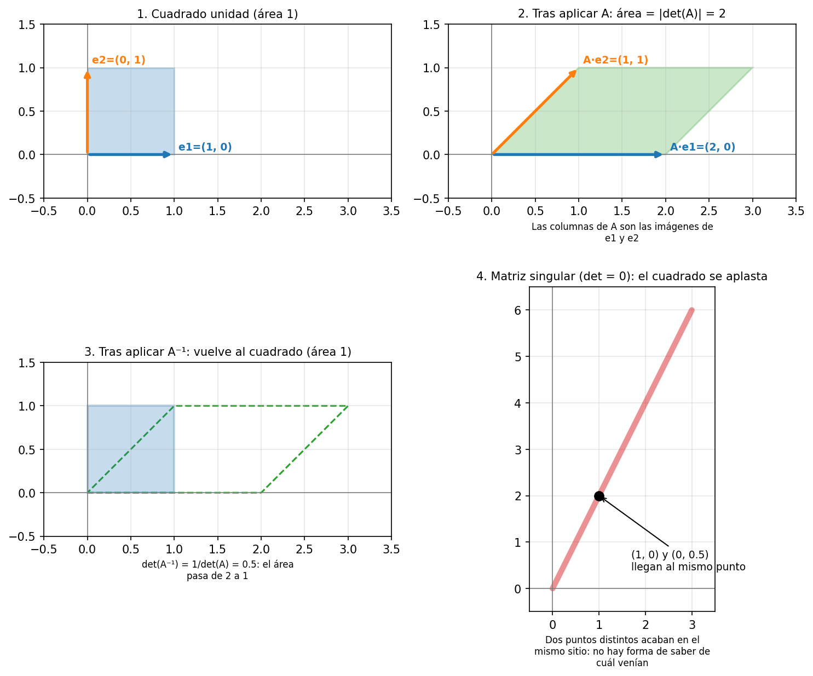
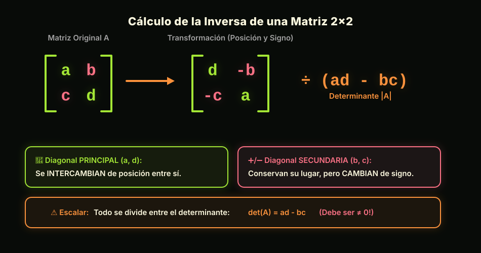
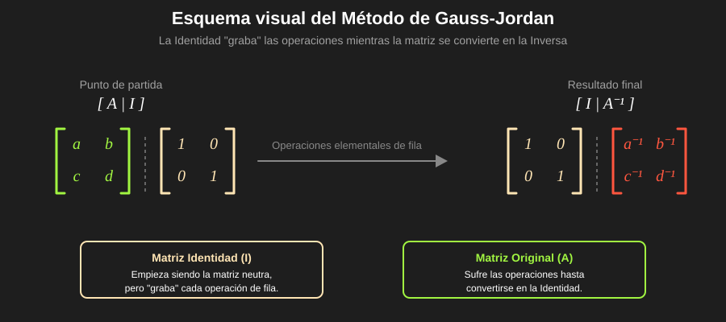

# 03-003: Matrices

- 3.5. Matriz Inversa
    - 3.5.1. ¿Por qué necesito comprender, calcular y usar la matriz inversa?
    
    - 3.5.2. La matriz Identidad: el "1" de las matrices
    
    - 3.5.3. Definición de matriz inversa: la condición de existencia
        - 3.5.3.1. La inversa, si existe, es única
        - 3.5.3.2. ¿Por qué $\det(A) \neq 0$?
        - 3.5.3.3. Afirmaciones equivalentes
    
    - 3.5.4. Interpretación geométrica: deshacer la información
    
    - 3.5.5. Inversa de una matriz $2 \times 2$
        - 3.5.5.1. Fórmula
        - 3.5.5.2. Ejemplo $2 \times 2$
    
    - 3.5.6. Inversa por la matriz adjunta (cofactores), para $n \times n$
        - 3.5.6.1. Fórmula de la Matriz de Cofactores / Matriz Adjunta
        - 3.5.6.2. ¿Por qué funciona? (Idea de la demostración)
        - 3.5.6.3. Caso $2 \times 2$: la fórmula de Inversa de una matriz (3.5.5) reaparece
        - 3.5.6.4. Ejemplo $3 \times 3$
    
    - 3.5.7. Inversa por el método de Gauss-Jordan
        - 3.5.7.1. ¿Por qué funciona? (idea de la demostración)
        - 3.5.7.2. Ejemplo 2×2
        - 3.5.7.3. Ejemplo 3×3, paso a paso
        - 3.5.7.4. ¿Qué pasa si la matriz es singular?
    
    - 3.5.8. El fascinante mundo de las matrices con inversa inmediata
        - 3.5.8.1. Matriz diagonal
        - 3.5.8.2. Matriz triangular
        - 3.5.8.3. Matriz de permutación
        - 3.5.8.4. Matriz ortogonal: la inversa es la traspuesta
    
    - 3.5.9. Propiedades de la matriz inversa
    
    - 3.5.10. Resolver sistemas y ecuaciones matriciales con la inversa
        - 3.5.10.1. Sistemas de ecuaciones: Ax = b
        - 3.5.10.2. Ecuaciones matriciales: AX = B frente a XA = B
    
    - 3.5.11. Cuando no hay inversa, o casi no la hay
    
    - 3.5.12. Matriz inversa en NumPy
        - 3.5.12.1. La identidad: `np.eye()` y `np.identity()`
        - 3.5.12.2. `np.linalg.inv()`, `np.allclose()` y `LinAlgError`
        - 3.5.12.3. Comprobación manual, deconstrucción paso a paso
        - 3.5.12.4. Matrices con inversa inmediata en NumPy
        - 3.5.12.5. Verificando las propiedades
        - 3.5.12.6. Sistemas y ecuaciones matriciales: `np.linalg.solve()+ 
        - 3.5.12.7. Matrices mal condicionadas: `np.linalg.cond()`


***

## 3.5. Matriz inversa

Con los números, el **inverso** de $a \neq 0$ es el número $a^{-1}$ que cumple $a \cdot a^{-1} = 1$:  
- **Multiplicar por él **DESHACE la multiplicación** por $a$.    

Con las matrices ocurre algo parecido, pero con **DOS diferencias** importantes:  

1.  El papel del $1$ lo hace la **matriz identidad** $I$  
2.  **No toda matriz tiene inversa**, al igual que "$0$" no tiene inverso  
  

Y, como las matrices **no se pueden "dividir" (directamente)**, multiplicar por la inversa es **la forma de "dividir"**.

> [!NOTE]
> En esta guía los índices empiezan en $0$, como en Python y como hemos usado para desarrollo por cofactores de **"Desarrollo por cofactores (Laplace), para $n \times n$"**, (3.4.4.2).  
  

***
  

### 3.5.1.  ¿Por qué necesito comprender, calcular y usar la matriz inversa?

* 1. **Resolver sistemas de ecuaciones lineales**
    - $A\mathbf{x} = \mathbf{b}$, con $A$ invertible, se resuelve como $\mathbf{x} = A^{-1}\mathbf{b}$ (ver *3.5.10, "Resolver sistemas y ecuaciones matriciales con la inversa"*)
    - Es la versión matricial de "despejar la incógnita"


* 2. **Despejar ecuaciones matriciales**  
    - $AX = B$ da $X = A^{-1}B$, y $XA = B$ da $X = BA^{-1}$ (ver *3.5.10, "Resolver sistemas y ecuaciones matriciales con la inversa"*)  
    - Aquí el **lado importa**, porque **el producto de matrices no es conmutativo**  


* 3. **Deshacer transformaciones**  
    - Si $A$ transforma vectores (gira, estira, inclina...), $A^{-1}$ **devuelve cada vector a su posición original** (ver *3.5.4, "Interpretación geométrica: deshacer la información"*)
    - Una transformación que **aplasta** el espacio (determinante cero) **no se puede deshacer**


* 4. **Saber si hay solución única y si hay información redundante**
    - $A$ es invertible $\iff \det(A) \neq 0$ (ver **3.4.6, "Matriz Singular"** y **3.5.3, "Definición de matriz inversa: la condición de existencia"**)
    - Si no lo es, sus filas o columnas son **linealmente dependientes**


* 5. **En álgebra lineal y ML**
    - La regresión lineal por mínimos cuadrados se escribe $\hat{\boldsymbol{\beta}} = (X^T X)^{-1} X^T \mathbf{y}$
    - **Solo existe si $X^T X$ es invertible**; si las columnas de $X$ son redundantes, no lo es
    - En la práctica, con las calculadoras o en la programación, se resuelven estos problemas **sin calcular la inversa explícitamente**, pero entenderlo y desarrollarmo manualmente es clave (ver *3.5.12.6, "Sistemas y ecuaciones matriciales: `np.linalg.solve()`"*)
  
> [!NOTE]
> Si me hubieran dicho de joven que en la programación de videojuegos, como en SNES y su Modo 7 rotando y escalando sprites, se sustentaban a través de matrices y transformaciones de matrices, no estaría a mis casi 40's desoxidándome de las matemáticas a las que un día di la espalda.    


***
  

### 3.5.2.  La matriz Identidad: el "1" de las matrices

La **matriz identidad** de orden $n$, $I_n$, es la matriz cuadrada con **unos en la diagonal principal y ceros el resto de posiciones**:

$$
I_2 =
\begin{pmatrix}
1 & 0 \\
0 & 1
\end{pmatrix}
\qquad
I_3 =
\begin{pmatrix}
1 & 0 & 0 \\
0 & 1 & 0 \\
0 & 0 & 1
\end{pmatrix}
$$

Es el **ELEMENTO NEUTRO** del producto de matrices:     *multiplicar por ella **no cambia nada***.    

$$
A \cdot I = I \cdot A = A
$$

| Propiedades de la matriz Identidad | Fórmula |
|---|---|
| Elemento neutro | $AI = IA = A$ |
| Su determinante | $\det(I) = 1$ |
| Su traspuesta | $I^T = I$ |
| Su cuadrado | $I \cdot I = I$ |
| Su inversa | $I^{-1} = I$ |
  

***

### 3.5.3. Definición de matriz inversa: la condición de existencia

Una matriz **cuadrada** $A$ tiene **inversa** $A^{-1}$ cuando:  

$$
\boxed{A A^{-1} = A^{-1} A = I}
$$

- Si existe, se dice que $A$ es **REGULAR** (o **INVERTIBLE**)
- Si no existe, se dice que $A$ es **singular**

> [!IMPORTANT]
> Solo las matrices **cuadradas** pueden tener inversa:  
>  
>   - Una matriz de forma $(2, 3)$ no tiene inversa, ni siquiera tiene determinante (ver *3.4.2, "Condición de Determinante: LA MATRIZ DEBE SER CUADRADA"*)
>  
>   - Y, **aunque sea cuadrada, solo la tiene si $\det(A) \neq 0$**  
  

#### 3.5.3.1. La inversa, si existe, es única

Supongamos que $B$ y $C$ son dos inversas de $A$. Entonces:  

$$
\begin{aligned}
B &= B \cdot I \\
&= B (A C) \\
&= (B A) C \\
&= I \cdot C \\
&= C
\end{aligned}
$$

- Las dos son **la misma matriz**, por eso podemos hablar de **"la" inversa** de $A$.  


##### 3.5.3.1.2     Ejemplo mínimo

Dada la matriz $A$, supongamos que alguien propone estas dos candidatas a inversa:

$$
A = \begin{pmatrix}
1 & 2 \\
3 & 4
\end{pmatrix}
$$


$$
B = \begin{pmatrix} -2 & 1 \\ \frac{3}{2} & -\frac{1}{2} \end{pmatrix}
\qquad
C = \begin{pmatrix} -4 & 2 \\ 3 & -1 \end{pmatrix} \cdot \frac{1}{2}
$$

A simple vista **parecen distintas**:  
- Una tiene fracciones  
- La otra tiene enteros

Pero al comprobar $AB = I$ y $AC = I$, **ambas cumplen**.  
Y al operar $C$:  


$$
C = \frac{1}{2}\begin{pmatrix} -4 & 2 \\ 3 & -1 \end{pmatrix}
=
\begin{pmatrix} -2 & 1 \\ \frac{3}{2} & -\frac{1}{2} \end{pmatrix} = B
$$

**Son la misma matriz, escrita de dos formas distintas**:   

- La **condición de existencia** dice que esto **siempre** es así: **NO puede tener dos inversas distintas.**  


#### 3.5.3.2. ¿Por qué $\det(A) \neq 0$?

Si $A$ tiene inversa:

1. Aplicamos el determinante a $A A^{-1} = I$.
2. Usamos la propiedad del producto de matrices (*"El determinante del producto es el producto de los determinantes"*), (ver *3.4.5, "Propiedades del determinante de una matriz"*):

$$
\det(A) \cdot \det(A^{-1}) = \det(I) = 1
$$

De aquí salen **dos conclusiones**:  

1.  **$\det(A) \neq 0$**
- Si $\det(A)$ fuera $0$, el producto $\det(A) \cdot \det(A^{-1})$ sería $0$, y no $1$
- Por lo que ... $\det(A)$ **NO puede ser cero** (*"Una matriz con inversa tiene determinante distinto de cero*")

2.  **$\det(A^{-1}) = \dfrac{1}{\det(A)}$**
- Despejando en la misma ecuación (y sabiendo ya que $\det(A) \neq 0$, por lo que se puede dividir entre él)
  

  


#### 3.5.3.3. Afirmaciones equivalentes

Para una matriz cuadrada $A$ de orden $n$, las siguientes afirmaciones son **equivalentes**:

- **Si una es cierta, lo son todas**
- **Si una es falsa, lo son todas**

| Afirmación equivalente | Detalle en ... |
|---|---|
| $A$ es **invertible** (existe $A^{-1}$) | *3.5.3, "Definición de matriz inversa"* |
| $\det(A) \neq 0$ | *3.4.6, "Matriz Singular"* |
| Las **filas** (o columnas) de $A$ son **linealmente independientes** | *3.4.6, "Matriz Singular"* |
| El **rango** de $A$ es $n$ | *3.4.7.7, "Un determinante pequeño NO siempre significa ser matriz singular"* |
| $A\mathbf{x} = \mathbf{b}$ tiene **solución única** para todo $\mathbf{b}$ | *3.5.10, "Resolver sistemas y ecuaciones matriciales con la inversa"* |
| $A$ se puede transformar en $I$ con operaciones elementales de fila | *3.5.7, "Inversa por el método de Gauss-Jordan"* |
  

***


### 3.5.4.  Interpretación geométrica: DESHACER la información

Recordando lo visto anteriormente en la interpretación geométrica de la determinate de matrices (*3.4.3*):  

> - Una matriz $2 \times 2$ **transforma el cuadrado unidad en el paralelogramo formado por sus columnas**  
> - $|\det(A)|$ es el factor por el que se multiplican las áreas  
  


Con la inversa, la forma de visualizarlo mentalmente a través de la lectura geométrica es muy natural:  

> [!IMPORTANT]
> Si $A^{-1}$ es la transformación que **DESHACE** a $A$:
>   - Entonces **devuelve cada punto transformado a su posición original**



- **Panel 1:**  
    - El cuadrado unidad, con $\mathbf{e}_1 = (1, 0)$ y $\mathbf{e}_2 = (0, 1)$ (área $1$)  
  

- **Panel 2:**  
    - $A = \begin{pmatrix} 2 & 1 \\ 0 & 1 \end{pmatrix}$ lo transforma en el paralelogramo de sus columnas, $(2, 0)$ y $(1, 1)$  
    - $\det(A) = 2 \cdot 1 - 1 \cdot 0 = 2$  
    - Es decir, **el área se duplica**  
  

- **Panel 3:**  
    - $A^{-1} = \begin{pmatrix} \frac{1}{2} & -\frac{1}{2} \\ 0 & 1 \end{pmatrix}$ lleva el paralelogramo **de vuelta al cuadrado unidad**  
    - $\det(A^{-1}) = \frac{1}{2} = \frac{1}{\det(A)}$  
    - Es decir, **el área se divide entre dos**  
  

- **Panel 4:**  
    - $\begin{pmatrix} 1 & 2 \\ 2 & 4 \end{pmatrix}$ tiene $\det = 0$
    - Es decir, **aplasta/colapsa** el cuadrado sobre un segmento:  
        * Puntos distintos acaban en el **mismo sitio**:  
            - Por ejemplo, $(1, 0)$ y $\left(0, \tfrac{1}{2}\right)$ van los dos a $(1, 2)$  
        * Dado ese punto de llegada, **no hay modo de saber de cuál procedía**:  
            - **no se puede deshacer**, es decir, **no existe inversa**  

> [!TIP]
> Una manera útil de pensarlo:
>   - **La inversa solo puede existir si la transformación NO pierde información**
>   - El determinante cero es la señal de que **sí la pierde**
  
***
  

### 3.5.5. Inversa de una matriz $2 \times 2$

#### 3.5.5.1. Fórmula

Dada una matriz de $2 \times 2$:

$$
A =
\begin{pmatrix}
a & b \\
c & d
\end{pmatrix}
$$

Si $ad - bc \neq 0$, su inversa es:

$$
\boxed{
A^{-1} = \frac{1}{ad - bc}
\begin{pmatrix}
d & -b \\
-c & a
\end{pmatrix}
}
$$
  
  
> [!WARNING]
> Si $ad - bc = 0$, la fórmula **divide entre cero**:  
>   - La matriz es singular y **NO tiene inversa**


Para visualizarlo mentalmente, recuerda las diagonales de **3.4.2.1.1, "Fórmula"** (del determinante $2 \times 2$):  


  


#### 3.5.5.2. Ejemplo $2 \times 2$

> [!NOTE]
> Esta fórmula **no es una regla suelta**:
>   - La reutilizaremos el caso $2 \times 2$ del método de la adjunta (en *3.5.6, "Inversa por la matriz adjunta (cofactores)*), para $n \times n$"**, y lo comprobaremos allí

Dada la matriz $A$:  

$$
A =
\begin{pmatrix}
1 & 2 \\
3 & 4
\end{pmatrix}
\qquad
\det(A) = 1 \cdot 4 - 2 \cdot 3 = -2
$$
  
$$
A^{-1} = \frac{1}{-2}
\begin{pmatrix}
4 & -2 \\
-3 & 1
\end{pmatrix}
=
\boxed{\begin{pmatrix}
-2 & 1 \\
\frac{3}{2} & -\frac{1}{2}
\end{pmatrix}}
$$

Comprobamos que $A A^{-1} = I$:  

$$
\begin{aligned}
\begin{pmatrix} 1 & 2 \\ 3 & 4 \end{pmatrix}
\begin{pmatrix} -2 & 1 \\ \frac{3}{2} & -\frac{1}{2} \end{pmatrix}
&=
\begin{pmatrix}
1 \cdot (-2) + 2 \cdot \frac{3}{2} & 1 \cdot 1 + 2 \cdot \left(-\frac{1}{2}\right) \\
3 \cdot (-2) + 4 \cdot \frac{3}{2} & 3 \cdot 1 + 4 \cdot \left(-\frac{1}{2}\right)
\end{pmatrix} \\
&=
\begin{pmatrix}
1 & 0 \\
0 & 1
\end{pmatrix}
\end{aligned}
$$
  

***
  

### 3.5.6. Inversa por la Matriz Adjunta (Matriz de Cofactores), para $n \times n$

Este método **generaliza la fórmula $2 \times 2$ a cualquier tamaño**, y reutiliza lo que ya conocemos de Laplace (*3.4.4.2, "Desarrollo por cofactores (Laplace)"*), para $n \times n$"**:

- **MENOR / MENOR COMPLEMENTARIO** $M_{ij}$: *el determinante que queda al **tachar la fila $i$ y la columna $j$***

- **COFACTOR** (o **adjunto**) $C_{ij} = (-1)^{i+j}\,M_{ij}$: *el menor con su **signo de "tablero de ajedrez"***


Pero, **añadimos dos definiciones nuevas:**

- **MATRIZ DE COFACTORES:**     *la matriz **formada por todos los cofactores** $C_{ij}$, cada uno en su posición (**SIN TRASPONER**)***

- **MATRIZ ADJUNTA** $\mathrm{adj}(A)$:     *la **traspuesta** de la matriz de cofactores*
  

#### 3.5.6.1. Fórmula de la Matriz de Cofactores / Matriz Adjunta

> [!WARNING]
> **Cuidado con los nombres y el desarrollo!**
>   
> En algunos textos, o algunos instructores, llaman "matriz adjunta" a la matriz de cofactores **SIN TRASPONER**, y escriben después la fórmula con $(\mathrm{Adj}\, A)^T$.
>   
> El resultado es el mismo, lo que importa es que **al final se haga la trasposición**.  
  

$$
\boxed{
A^{-1} = \frac{1}{\det(A)} \,\mathrm{adj}(A)
}
\qquad\text{con}\qquad
\mathrm{adj}(A) = (C_{ij})^T
\qquad\Longleftrightarrow\qquad
(A^{-1})_{ij} = \frac{C_{ji}}{\det(A)}
$$
  

#### 3.5.6.2. ¿Por qué funciona? (Idea de la demostración)

El producto de $A$ por su adjunta sale **diagonal**:  

$$
A \cdot \mathrm{adj}(A) = \det(A) \cdot I
$$

- **ELEMENTOS DE LA DIAGONAL**  
    - La fila $i$ de $A$ multiplicada por los cofactores de **esa misma fila** es **exactamente el desarrollo de Laplace**:  
        * Da $\det(A)$  

- **Elementos FUERA de la diagonal**
    - La fila $i$ multiplicada por los cofactores de **otra fila** equivale al determinante de una matriz con **dos filas iguales**:  
        * Da $0$ (propiedad 7 de *3.4.5, "Propiedades del determinante de una matriz"*):  
        * *"Un determinante que tiene dos filas o dos columnas idénticas es nulo. Y si son proporcionales, también, porque sacando el factor común quedan dos líneas iguales."* 
  
  
  
**Dividiendo entre $\det(A)$ aparece la Identidad, y por eso $\dfrac{\mathrm{adj}(A)}{\det(A)}$ es la inversa.**  
  


#### 3.5.6.3.   Caso $2 \times 2$

Dada la matriz $A$:  

$$
A = \begin{pmatrix} 
a & b \\
c & d
\end{pmatrix}
$$$

Sus cuatro cofactores serán:  

$$
C_{00} = +d \qquad C_{01} = -c \qquad C_{10} = -b \qquad C_{11} = +a
$$

$$
\text{matriz de cofactores} = \begin{pmatrix} d & -c \\ -b & a \end{pmatrix}
\xrightarrow{\ \text{trasponer}\ }
\mathrm{adj}(A) = \begin{pmatrix} d & -b \\ -c & a \end{pmatrix}
$$


Es exactamente la matriz de la fórmula $2 \times 2$: **la trasposición es la que intercambia $b$ y $c$ de sitio**.

  


#### 3.5.6.4. Ejemplo $3 \times 3$

$$
K =
\begin{pmatrix}
1 & 2 & 3 \\
0 & 1 & 4 \\
5 & 6 & 0
\end{pmatrix}
$$

Su determinante, desarrollando por la primera fila:  

$$
\det(K) = 1 \cdot (0 - 24) - 2 \cdot (0 - 20) + 3 \cdot (0 - 5) = -24 + 40 - 15 = \boxed{1}
$$

Como es distinto de cero, **tiene inversa**.  
  
Entonces, **calculamos los nueve cofactores**:  

| Cofactor | Menor (tachando fila $i$ y columna $j$) | Cálculo | Valor |
|---|---|---|---|
| $C_{00}$ | `[[1, 4], [6, 0]]` | $+(1 \cdot 0 - 4 \cdot 6)$ | $-24$ |
| $C_{01}$ | `[[0, 4], [5, 0]]` | $-(0 \cdot 0 - 4 \cdot 5)$ | $20$ |
| $C_{02}$ | `[[0, 1], [5, 6]]` | $+(0 \cdot 6 - 1 \cdot 5)$ | $-5$ |
| $C_{10}$ | `[[2, 3], [6, 0]]` | $-(2 \cdot 0 - 3 \cdot 6)$ | $18$ |
| $C_{11}$ | `[[1, 3], [5, 0]]` | $+(1 \cdot 0 - 3 \cdot 5)$ | $-15$ |
| $C_{12}$ | `[[1, 2], [5, 6]]` | $-(1 \cdot 6 - 2 \cdot 5)$ | $4$ |
| $C_{20}$ | `[[2, 3], [1, 4]]` | $+(2 \cdot 4 - 3 \cdot 1)$ | $5$ |
| $C_{21}$ | `[[1, 3], [0, 4]]` | $-(1 \cdot 4 - 3 \cdot 0)$ | $-4$ |
| $C_{22}$ | `[[1, 2], [0, 1]]` | $+(1 \cdot 1 - 2 \cdot 0)$ | $1$ |

**Matriz de cofactores**, su **traspuesta** (la adjunta) y el resultado:

$$
\begin{pmatrix}
-24 & 20 & -5 \\
18 & -15 & 4 \\
5 & -4 & 1
\end{pmatrix}
\xrightarrow{\ \text{trasponer}\ }
\mathrm{adj}(K) =
\begin{pmatrix}
-24 & 18 & 5 \\
20 & -15 & -4 \\
-5 & 4 & 1
\end{pmatrix}
$$

$$
K^{-1} = \frac{1}{1}
\begin{pmatrix}
-24 & 18 & 5 \\
20 & -15 & -4 \\
-5 & 4 & 1
\end{pmatrix}
=
\boxed{\begin{pmatrix}
-24 & 18 & 5 \\
20 & -15 & -4 \\
-5 & 4 & 1
\end{pmatrix}}
$$
  

> [!WARNING]
> **La trampa de la trasposición:** olvidar trasponer la matriz de cofactores es el error más habitual de este método. En este ejemplo, sin trasponer, la matriz resultasnte **NO sería la inversa**.
  

> [!NOTE]
> Este método es **muy útil para entender** la inversa, pero **no es rentable para matrices grandes**:  
> - Hay que calcular $n^2$ determinantes de tamaño $(n-1) \times (n-1)$, cada uno con el crecimiento $n!$ (visto en *3.4.4.2.3, "Casos grandes, $5 \times 5$: Estrategia de 'crear ceros'"*)
  

***


### 3.5.7. Inversa por el método de Gauss-Jordan

Es el método **más práctico**,y el que que sirve de base a la computación-en la programación.  

Usa las **mismas operaciones elementales entre filas** que vimos en la estrategia de "crear ceros" (*3.4.4.2.3*), **pero con un objetivo distinto**.


La idea principal es:  

1.  Escribir $A$ **junto a la Identidad**, $[\,A \mid I\,]$
2.  Aplicar operaciones elementales de fila hasta convertir **la parte izquierda en $I$**
3.  La parte derecha se habrá convertido en $A^{-1}$:

$$
\boxed{[A \mid I] \;\longrightarrow\; [I \mid A^{-1}]}
$$




**Operaciones elementales de fila permitidas:**  

1. **INTERCAMBIAR** dos filas ($F_i \leftrightarrow F_j$)
2. **MULTIPLKICAR** una fila por un número **distinto de cero** ($F_i \to k F_i$)
3. **SUMAR A UNA FILA EL MULTILPLO DE OTRA** ($F_i \to F_i + k F_j$)


> [!NOTE]
> Las filas se nombran $F_1, F_2, F_3$ (empezando en $1$), como en *3.4.4.2.3, "Casos grandes, $5 \times 5$"***.  
> En Python sería zero-based.  
  
    
#### 3.5.7.1. ¿Por qué funciona? (idea de la demostración)

Cada operación elemental equivale a **multiplicar por la izquierda** por una matriz $E$ (matriz elemental).  
  
Entonces, aplicar una secuencia de operaciones a $A$ hasta llegar a la identidad es:  


$$
E_k \cdots E_2 E_1 A = I
\qquad\Longrightarrow\qquad
E_k \cdots E_2 E_1 = A^{-1}
$$

Y aplicar **esas mismas operaciones a $I$** da:  

$$
E_k \cdots E_2 E_1 I = E_k \cdots E_2 E_1 = A^{-1}
$$

Por eso lo que queda a la derecha **es la inversa**:  

- **La Identidad ha ido anotando el producto de todas las operaciones**.
  
    

#### 3.5.7.2.   Ejemplo $2 \times 2$

$$
A =
\begin{pmatrix}
1 & 2 \\
3 & 4
\end{pmatrix}
$$

$$
\left(\begin{array}{cc|cc}
1 & 2 & 1 & 0 \\
3 & 4 & 0 & 1
\end{array}\right)
\xrightarrow{F_2 \to F_2 - 3F_1}
\left(\begin{array}{cc|cc}
1 & 2 & 1 & 0 \\
0 & -2 & -3 & 1
\end{array}\right)
$$

$$
\xrightarrow{F_2 \to F_2 / (-2)}
\left(\begin{array}{cc|cc}
1 & 2 & 1 & 0 \\
0 & 1 & \frac{3}{2} & -\frac{1}{2}
\end{array}\right)
\xrightarrow{F_1 \to F_1 - 2F_2}
\left(\begin{array}{cc|cc}
1 & 0 & -2 & 1 \\
0 & 1 & \frac{3}{2} & -\frac{1}{2}
\end{array}\right)
$$

La parte derecha es $A^{-1}$, el mismo resultado que con la fórmula $2 \times 2$ de *3.5.5, "Inversa de una matriz $2 \times 2$"*.


> [!NOTE]
> No hemos entrado en código aún pero anoto la comprobación en NumPy:
>  
 ```python
A = np.array([[1, 2], [3, 4]])

print(np.allclose(np.linalg.inv(A), [[-2, 1], [1.5, -0.5]]))  # True
```
  
  

#### 3.5.7.3.   Ejemplo $3 \times 3$, paso a paso

Con la misma matriz $K$ de *3.5.6.4, "Ejemplo $3 \times 3$"*, para poder comparar:

$$
\left(\begin{array}{ccc|ccc}
1 & 2 & 3 & 1 & 0 & 0 \\
0 & 1 & 4 & 0 & 1 & 0 \\
5 & 6 & 0 & 0 & 0 & 1
\end{array}\right)
$$

El procedimiento tiene **dos fases**:

1.  **HACIA ABAJO (fase de Gauss):**    *crear ceros **por debajo** de la diagonal*

2.  **HACIA ARRIBA (fase de Jordan):**  *crear ceros **por encima** de la diagonal*


- **1. FASE DE GAUSS:     ceros por debajo**

1. **$F_3 \to F_3 - 5F_1$**:    *anulamos el $5$ de la posición $(3,1)$*

$$
\left(\begin{array}{ccc|ccc}
1 & 2 & 3 & 1 & 0 & 0 \\
0 & 1 & 4 & 0 & 1 & 0 \\
0 & -4 & -15 & -5 & 0 & 1
\end{array}\right)
$$
  


2.  **$F_3 \to F_3 + 4F_2$**:   *anulamos el $-4$ de la posición $(3,2)$*

$$
\left(\begin{array}{ccc|ccc}
1 & 2 & 3 & 1 & 0 & 0 \\
0 & 1 & 4 & 0 & 1 & 0 \\
0 & 0 & 1 & -5 & 4 & 1
\end{array}\right)
$$
  
  
La parte izquierda ya es **triangular superior** y todos los elementos de la diagonal valen $1$.
  
  
- **2.  FASE DE JORDAN: ceros por encima**  
  
3.  **$F_2 \to F_2 - 4F_3$** y **$F_1 \to F_1 - 3F_3$**: *anulamos la tercera columna por encima*

$$
\left(\begin{array}{ccc|ccc}
1 & 2 & 0 & 16 & -12 & -3 \\
0 & 1 & 0 & 20 & -15 & -4 \\
0 & 0 & 1 & -5 & 4 & 1
\end{array}\right)
$$
  


4.  **$F_1 \to F_1 - 2F_2$**:   *anulamos el $2$ de la posición $(1,2)$.*

$$
\left(\begin{array}{ccc|ccc}
1 & 0 & 0 & -24 & 18 & 5 \\
0 & 1 & 0 & 20 & -15 & -4 \\
0 & 0 & 1 & -5 & 4 & 1
\end{array}\right)
$$
  

**La parte derecha es $K^{-1}$, **idéntica** a la que obtuvimos por la adjunta.**

> [!NOTE]
> La implementación en NumPy de este método, con su versión **compacta** (una columna cada vez, anulando arriba y abajo con el pivote normalizado a $1$) está en *3.5.12.3, "Comprobación manual, deconstrucción paso a paso"*.  
>   
> Es la misma idea, con las operaciones reordenadas para que el código sea más corto.
  


#### 3.5.7.4. ¿Qué pasa si la matriz es singular?

> [!IMPORTANT]
> **El método de Gauss-Jordan te dice a la vez si la inversa existe y cuál es.**  
>   
> - Si llegas a $I$, la matriz es regular y tienes su inversa
> - Si aparece una fila de ceros a la izquierda, es singular.


Si en algún paso **aparece una fila de ceros en la parte izquierda**:   
- **No se podrá llegar a $I$**, por lo que la matrzi **NO tendrá inversa**  
  

$$
\left(\begin{array}{cc|cc}
1 & 2 & 1 & 0 \\
2 & 4 & 0 & 1
\end{array}\right)
\xrightarrow{F_2 \to F_2 - 2F_1}
\left(\begin{array}{cc|cc}
1 & 2 & 1 & 0 \\
0 & 0 & -2 & 1
\end{array}\right)
$$
  

Como ves, la segunda fila de la izquierda es cero:

- La matriz $\begin{pmatrix} 1 & 2 \\ 2 & 4 \end{pmatrix}$ es singular (su determinante es $1 \cdot 4 - 2 \cdot 2 = 0$, ver *3.4.6, "Matriz Singular"*).
  


> [!TIP]
> **¿Qué método usar?**
>
> | Situación | Método recomendado |
> |---|---|
> | $2 \times 2$ | La fórmula directa (*3.5.5, "Inversa de una matriz $2 \times 2$"*) |
> | $3 \times 3$, a mano | Adjunta (*3.5.6*) o Gauss-Jordan (**3.5.7**) |
> | Más grande, a mano | Gauss-Jordan (*3.5.7*) |


***


[ PENDIENTE DESDE AQUI]


